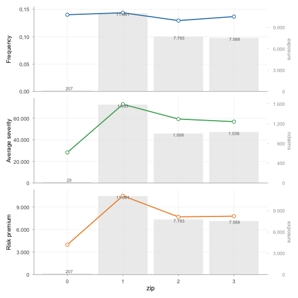
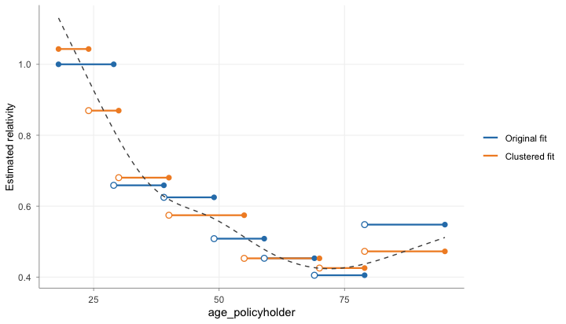

<!-- README.md is generated from README.Rmd. Please edit that file -->

# insurancerating 

<!-- badges: start -->

[](https://cran.r-project.org/package=insurancerating)
[](https://cran.r-project.org/package=insurancerating)

<!-- badges: end -->

`insurancerating` provides actuarial tools for insurance pricing in R.
It works alongside standard modelling functions such as `glm()` to help
you analyse portfolio experience, interpret and refine tariff
relativities, and validate fitted models. It also supports risk-factor
structuring, large-loss treatment and preparation of large portfolios.

The building blocks can be used independently or combined to suit the
portfolio. The examples illustrate choices, not a prescribed
methodology.

## Installation

Install the CRAN version, or install the development version from
GitHub:

``` r
install.packages("insurancerating")

# install.packages("remotes")
remotes::install_github("MHaringa/insurancerating")
```

## Explore portfolio experience

`factor_analysis()` summarises observed experience and the exposure
supporting each level of a rating factor. These unadjusted portfolio
patterns are useful before modelling, but should not be interpreted as
conditional tariff relativities. Compare an apparent difference with the
exposure and claim count behind it.

``` r
library(insurancerating)

portfolio <- as.data.frame(MTPL)
portfolio$zip <- factor(portfolio$zip)

zip_analysis <- factor_analysis(
  portfolio,
  risk_factors = "zip",
  claim_count = "nclaims",
  exposure = "exposure",
  claim_amount = "amount"
)

autoplot(
  zip_analysis,
  metrics = c("frequency", "average_severity", "risk_premium")
)
```



## From model to refined tariff

An age-band GLM estimates one relativity per band. Smoothing proposes a
continuous relationship, which can then be translated into a new set of
bands.

``` r
age_breaks <- c(18, 25, 32, 39, 51, 58, 65, 84, 95)
portfolio$age_band <- cut(portfolio$age_policyholder, age_breaks,
                          include.lowest = TRUE)

frequency_model <- glm(
  nclaims ~ age_band + offset(log(exposure)),
  family = poisson(),
  data = portfolio
)

tariff_breaks <- c(18, 24, 30, 40, 55, 70, 85, 95)
proposal <- frequency_model |>
  prepare_refinement(data = portfolio) |>
  add_smoothing("age_band", "age_policyholder", breaks = tariff_breaks,
                k = 5, weights = "exposure")

tariff <- refit(proposal, intercept_only = TRUE)
autoplot(proposal) +
  ggplot2::labs(x = "Policyholder age", y = "Tariff relativity") +
  ggplot2::theme(legend.position = "bottom")
```



The blue steps are the original GLM estimates. The dashed curve is the
smoothing proposal; the orange steps are the resulting tariff bands.
`refit()` holds those band effects fixed and re-estimates the base claim
rate, so their relativities do not move again. See the [refinement
example](https://mharinga.github.io/insurancerating/articles/refinement-workflow.html#quick-start)
for how to inspect the fitted result.

## What does insurancerating help with?

| Pricing task | Main tools |
|----|----|
| Explore portfolio experience | `factor_analysis()`, `outlier_histogram()` |
| Structure continuous risk factors | `risk_factor_gam()`, `derive_tariff_segments()` |
| Interpret fitted model effects | `rating_table()`, `add_factor_experience()` |
| Refine tariff structures | `prepare_refinement()`, `add_smoothing()`, `add_restriction()`, `refit()` |
| Validate fitted models | `model_performance()`, `calibration_analysis()`, `check_residuals()`, `validate_performance()` |
| Treat large losses | `assess_excess_threshold()`, `redistribute_excess_loss()` |
| Reduce portfolio data locally | `rating_grid()`, `merge_date_ranges()` |
| Reduce portfolios in a database | `rating_grid_db()`, `merge_date_ranges_db()` |

## Where should I start?

- [Getting
  Started](https://mharinga.github.io/insurancerating/articles/getting-started.html)
  Follow one portfolio through risk-factor analysis, modelling,
  technical risk premium, interpretation, validation and refinement.

- [Pricing workflow and package building
  blocks](https://mharinga.github.io/insurancerating/articles/pricing-workflow-building-blocks.html)
  See how the main actuarial pricing tasks and package components fit
  together.

- [Refinement building
  blocks](https://mharinga.github.io/insurancerating/articles/refinement-workflow.html)
  Translate estimated model effects into an explicit, reviewable and
  implementable tariff structure.

- [Model
  validation](https://mharinga.github.io/insurancerating/articles/model-validation.html)
  Assess model fit, stability and tariff plausibility, compare observed
  with expected claims, and evaluate predictions on later periods. Start
  with the [quick
  start](https://mharinga.github.io/insurancerating/articles/model-validation.html#quick-start).

- [Large
  Portfolios](https://mharinga.github.io/insurancerating/articles/large-portfolios.html)
  Reduce production-sized portfolios with model-point aggregation and
  database-backed workflows.

## Project information

- [Package website](https://mharinga.github.io/insurancerating/)
- [CRAN package](https://cran.r-project.org/package=insurancerating)
- [Issue tracker](https://github.com/MHaringa/insurancerating/issues)
- Citation information is available with `citation("insurancerating")`.
- The package is distributed under the GPL (\>= 2) licence.
