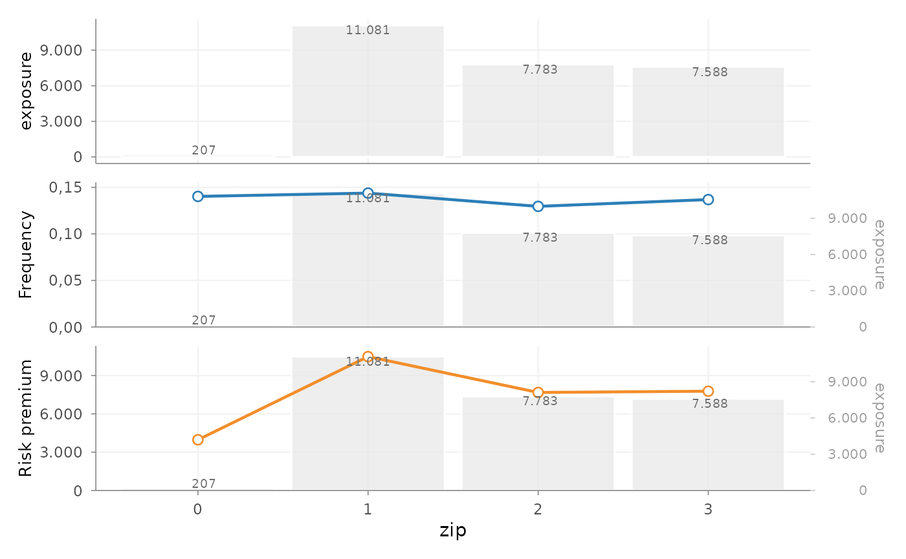
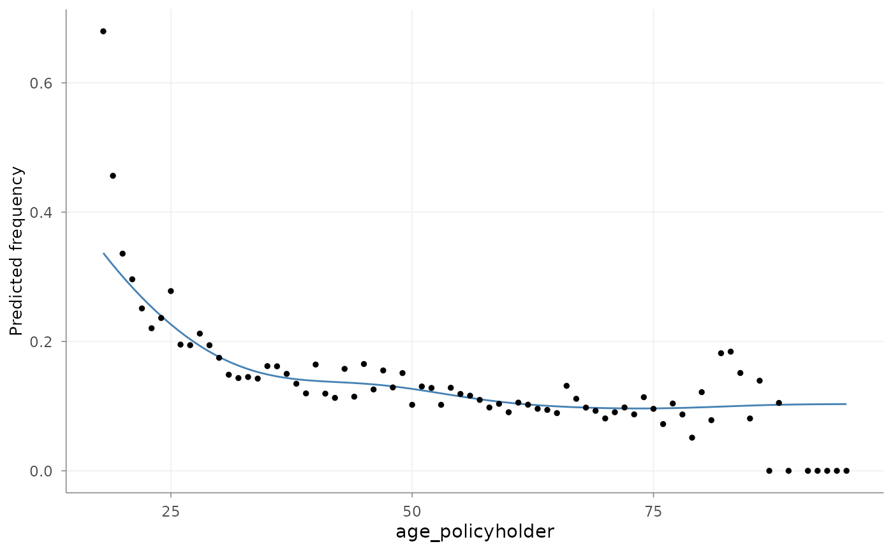
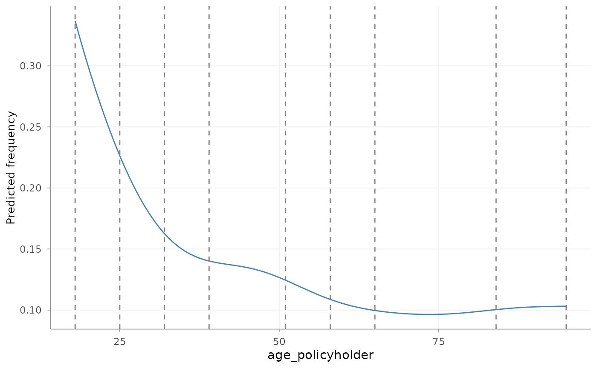
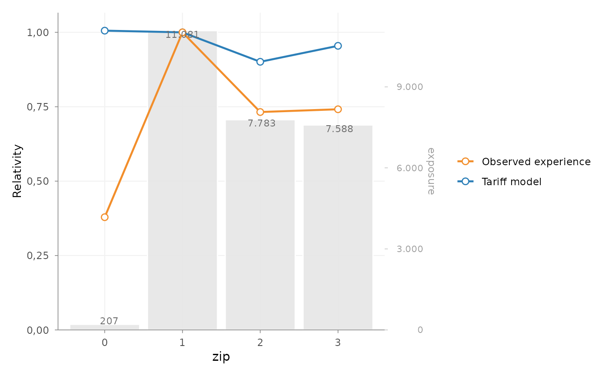
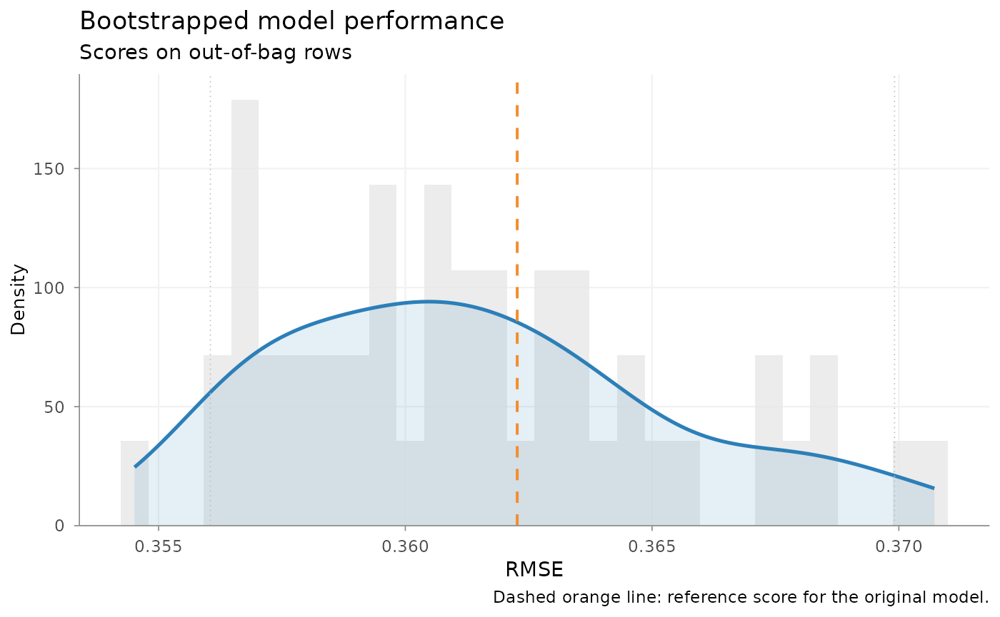

# Getting Started

## Introduction

This example uses a motor insurance portfolio to estimate claim
frequency and severity, combine them into a technical risk premium, and
represent that premium with a simpler tariff. Along the way, it shows
how to review observed experience, check the frequency model and make an
explicit tariff adjustment.

The package complements standard R modelling with actuarial tools for
interpreting fitted effects, turning them into tariffs and testing how
they perform. This example combines a few of those tools. The choice and
order depend on the portfolio and pricing question. The [motor insurance
case
study](https://mharinga.github.io/insurancerating/articles/motor-pricing-case-study.md)
shows a longer example with several years of data and a separate
evaluation year.

## Portfolio and data

The examples consistently use `MTPL`, a motor portfolio with:

- number of claims (`nclaims`),
- earned exposure in policy-years (`exposure`),
- total claim cost per portfolio record (`amount`),
- several rating factors

``` r


library(insurancerating)
library(dplyr)

head(MTPL)
#> # A tibble: 6 × 7
#>   age_policyholder nclaims exposure amount power    bm zip  
#>              <int>   <int>    <dbl>  <dbl> <int> <int> <fct>
#> 1               70       0    1          0   106     5 1    
#> 2               40       0    1          0    74     3 1    
#> 3               78       0    1          0    65     8 2    
#> 4               49       0    1          0    64    10 1    
#> 5               59       0    1          0    29     1 3    
#> 6               71       0    0.455      0    66     6 3
```

## Understanding rating factors

### Factor analysis

Here we use a descriptive review before fitting a model. The same review
can help later when a fitted effect or tariff change warrants a closer
look:

- how experience differs across factor levels
- whether observed differences are supported by sufficient exposure and
  claim volume
- whether the observed pattern is plausible

This is done with
[`factor_analysis()`](https://mharinga.github.io/insurancerating/reference/factor_analysis.md).

### Basic factor analysis

We start by analysing a single risk factor.

``` r


fa <- factor_analysis(
  MTPL,
  risk_factors = "zip",
  claim_count = "nclaims",
  exposure = "exposure",
  claim_amount = "amount"
)

fa
#>   zip    amount nclaims   exposure frequency average_severity risk_premium
#> 1   1 116178669    1593 11080.6274 0.1437644         72930.74    10484.846
#> 2   2  59751985    1008  7782.6301 0.1295192         59277.76     7677.608
#> 3   3  58988962    1038  7587.5644 0.1368028         56829.44     7774.427
#> 4   0    821510      29   206.8438 0.1402024         28327.93     3971.644
```

The output provides commonly used portfolio metrics such as:

- frequency = claims / exposure
- average severity = loss / claims
- risk premium = loss / exposure

Loss ratio and average premium can also be calculated when an
earned-premium column is supplied. `MTPL` does not contain that
quantity, so they are not used in this example.

### Visualising factor behaviour

``` r


autoplot(fa, metrics = c("exposure", "frequency", "risk_premium"))
```



This provides a direct view of:

- the distribution of exposure
- the variation in claim frequency
- the variation in risk premium

These are descriptive, univariate results. They show the observed
experience and volume by level, but do not control for correlations with
other risk factors.

## Handling continuous variables

### Why continuous variables are treated separately

Continuous variables can be modelled directly. In many traditional
insurance tariffs, they are instead translated into a limited number of
segments to improve stability, interpretation and implementation. This
example uses the following sequence:

1.  analysed as continuous variables
2.  translated into tariff segments
3.  used in a GLM as categorical rating factors

Grouping makes the resulting tariff effect discrete and directly
implementable, but introduces a segmentation choice that should be
reviewed.

### Analysing the shape with a GAM

``` r


age_freq <- risk_factor_gam(
  data = MTPL,
  risk_factor = "age_policyholder",
  claim_count = "nclaims",
  exposure = "exposure"
)

autoplot(age_freq, show_observations = TRUE)
```



This step is used to inspect:

- non-linear patterns
- local volatility
- areas with low exposure
- plausible breakpoints for tariff segments

### Deriving tariff segments

``` r


age_segments <- derive_tariff_segments(age_freq)
autoplot(age_segments)
```



``` r

summary(age_segments)
#>   segment portfolio_records risk_factor_values   exposure claim_count
#> 1 [18,25]              1543                  8 1331.17534         348
#> 2 (25,32]              4254                  7 3648.72055         653
#> 3 (32,39]              4919                  7 4247.34795         615
#> 4 (39,51]              8366                 12 7421.35890        1009
#> 5 (51,58]              3594                  7 3245.45479         372
#> 6 (58,65]              3058                  7 2790.83288         272
#> 7 (65,84]              4181                 19 3900.75890         394
#> 8 (84,95]                85                 10   72.01644           5
#>    frequency
#> 1 0.26142311
#> 2 0.17896684
#> 3 0.14479624
#> 4 0.13595893
#> 5 0.11462184
#> 6 0.09746194
#> 7 0.10100599
#> 8 0.06942859
```

This derives candidate segment boundaries from the fitted continuous
effect. Exposure and claim volume have already informed the GAM
estimate. They are reported by
[`summary()`](https://rdrr.io/r/base/summary.html) for review, but are
not applied again when the fitted curve is divided into intervals. The
evolutionary tree approximates the GAM curve rather than the individual
claim outcomes. Each distinct risk-factor value on the fitted curve has
equal influence on this approximation; exposure is not applied as a
second weight.

The oldest band contains little exposure and few claims compared with
the other bands. A different set of boundaries may give a more stable
estimate there. The example retains the candidate bands to illustrate
how they are used.

### Adding tariff segments to the data

``` r


dat <- MTPL |>
  add_tariff_segments(age_segments, name = "age_cat") |>
  mutate(across(where(is.character), as.factor)) |>
  mutate(across(where(is.factor), ~ set_reference_level(., exposure)))
```

[`set_reference_level()`](https://mharinga.github.io/insurancerating/reference/set_reference_level.md)
sets the reference level to the level with the highest exposure. This
changes the coefficient parameterisation, not the fitted values. A
high-exposure level is often a useful baseline because its relativity is
supported by a substantial part of the portfolio.

## Estimating frequency and severity

### Why GLMs are used

Generalized linear models are widely used in insurance pricing. They
can:

- accommodate non-normal response distributions
- produce interpretable multiplicative effects
- be translated into tariff relativities

A common decomposition is:

- frequency –\> Poisson GLM
- severity –\> Gamma GLM

### Frequency model

``` r


mod_freq <- glm(
  nclaims ~ age_cat + zip + bm,
  offset = log(exposure),
  family = poisson(),
  data = dat
)
```

The response is the observed claim count for each policy-period. Because
`log(exposure)` is included as an offset,
`predict(mod_freq, type = "response")` returns the expected number of
claims for that record’s exposure. Dividing that prediction by exposure
gives claim frequency per exposure-year. The frequency model also
includes ZIP code and bonus-malus score (`bm`).

### Severity model

``` r


severity_data <- dat |>
  filter(nclaims > 0, amount > 0) |>
  mutate(average_claim_amount = amount / nclaims)

mod_sev <- glm(
  average_claim_amount ~ age_cat,
  weights = nclaims,
  family = Gamma(link = "log"),
  data = severity_data
)
```

`amount` is the total claim cost recorded for a portfolio row. Dividing
by `nclaims` gives average claim severity. Claim count is then used as
the model weight because a row containing several claims represents more
severity observations than a row containing one claim. Frequency and
severity are modelled separately because they describe different parts
of the loss process. In these data, every row with claims has a positive
total claim amount.

## Constructing technical risk premium

``` r


premium_df <- dat |>
  add_prediction(
    mod_freq,
    mod_sev,
    predictions = c("expected_claim_count", "expected_average_severity")
  ) |>
  mutate(
    claim_frequency = expected_claim_count / exposure,
    expected_loss = expected_claim_count * expected_average_severity,
    risk_premium = claim_frequency * expected_average_severity
  )

premium_df |>
  select(
    exposure,
    expected_claim_count,
    claim_frequency,
    expected_average_severity,
    expected_loss,
    risk_premium
  ) |>
  head()
#>    exposure expected_claim_count claim_frequency expected_average_severity
#> 1 1.0000000           0.10526885      0.10526885                  63357.63
#> 2 1.0000000           0.14216313      0.14216313                  60320.26
#> 3 1.0000000           0.09427870      0.09427870                  63357.63
#> 4 1.0000000           0.14013316      0.14013316                  60320.26
#> 5 1.0000000           0.09784983      0.09784983                  50985.39
#> 6 0.4547945           0.04561253      0.10029261                  63357.63
#>   expected_loss risk_premium
#> 1      6669.585     6669.585
#> 2      8575.317     8575.317
#> 3      5973.275     5973.275
#> 4      8452.869     8452.869
#> 5      4988.911     4988.911
#> 6      2889.902     6354.302
```

The units are now explicit:

- `expected_claim_count` is the expected number of claims for the
  observed policy exposure;
- `claim_frequency` is the expected number of claims per exposure-year;
- `expected_average_severity` is the expected amount per claim;
- `expected_loss` is the expected loss for the policy-period;
- `risk_premium` is expected loss per exposure-year.

The risk premium is a technical expected loss cost. It does not include
expense loadings, profit margins, taxes or other components of a
commercial premium.

## From technical risk to tariff

### Fitting a tariff representation

``` r


tariff_model <- glm(
  risk_premium ~ age_cat + zip,
  weights = exposure,
  family = Gamma(link = "log"),
  data = premium_df
)
```

This second GLM is not statistically required after fitting frequency
and severity. Here it is used as a tariff-construction step: it
approximates the combined technical risk with a compact multiplicative
structure based on `age_cat` and `zip`. The technical target varies by
bonus-malus score as well as age and ZIP; this example deliberately
leaves bonus-malus out of the tariff to show how the more detailed
target can be represented by fewer factors. Exposure weights give more
influence to records that represent a larger part of the portfolio.

The response is a fitted technical target rather than an observed claim
outcome. The model is therefore used to obtain an interpretable and
implementable tariff representation, not as a replacement for the
underlying frequency and severity analyses.

## Interpreting model effects and observed experience

### Rating table

``` r


rt <- rating_table("Tariff model" = tariff_model) |>
  add_factor_experience(
    data = premium_df,
    claim_count = "nclaims",
    exposure = "exposure",
    claim_amount = "amount",
    metric = "risk_premium"
  )
rt
#>    risk_factor       level est_Tariff model exposure observed_relativity
#> 1  (Intercept) (Intercept)     8553.9835542       NA                  NA
#> 2      age_cat     [18,25]        1.9861849     1331           1.9848879
#> 3      age_cat     (25,32]        2.0940331     3649           2.0914417
#> 4      age_cat     (32,39]        1.0317012     4247           1.0312559
#> 5      age_cat     (39,51]        1.0000000     7421           1.0000000
#> 6      age_cat     (51,58]        0.5823491     3245           0.5826148
#> 7      age_cat     (58,65]        0.6068409     2791           0.6059124
#> 8      age_cat     (65,84]        0.7810566     3901           0.7803242
#> 9      age_cat     (84,95]        0.6219895       72           0.6199937
#> 10         zip           0        1.0056518      207           0.3787985
#> 11         zip           1        1.0000000    11081           1.0000000
#> 12         zip           2        0.9010247     7783           0.7322576
#> 13         zip           3        0.9546628     7588           0.7414917
```

[`rating_table()`](https://mharinga.github.io/insurancerating/reference/rating_table.md)
reports fitted tariff relativities by factor level.
[`add_factor_experience()`](https://mharinga.github.io/insurancerating/reference/add_factor_experience.md)
adds `observed_relativity`: here, the observed risk premium relative to
the reference level of each factor. The same values appear in the plot.
Exposure helps put differences between the two in context.

### Visualising coefficients

``` r


autoplot(rt, risk_factors = "zip", metric = "risk_premium")
```



The largest gap is for ZIP category 0, which has only about 207
policy-years. The observed relativity reflects the claims and risk mix
of that group. The modelled relativity describes the ZIP effect in the
tariff, holding age fixed. The gap merits checking against the available
experience; it does not, on its own, indicate an adjustment.

## Validating the frequency model

The diagnostics below assess `mod_freq`, the Poisson claim-frequency
model. They do not validate `tariff_model`, which approximates the
combined frequency and severity predictions. To assess the tariff
itself, check the fit to that technical target and compare expected and
observed losses on the same exposure basis in appropriate evaluation
data.

### Overdispersion

``` r


check_overdispersion(mod_freq)
#> Dispersion ratio =     1.185
#> Pearson's Chi-squared = 35531.969
#> p-value =   < 0.001
#> Overdispersion detected.
```

For a Poisson frequency model, a dispersion ratio materially above one
can indicate remaining heterogeneity or an unsuitable variance
assumption. The result should be considered together with residual and
factor-level checks.

### Model performance

``` r


model_performance(mod_freq)
#> # Comparison of Model Performance Indices
#> 
#>  Model   |    AIC    |    BIC    | RMSE  | Residual_Deviance 
#> ---------+-----------+-----------+-------+------------------ 
#> mod_freq | 22949.959 | 23049.666 | 0.362 |         16072.262
```

This reports AIC, BIC, response-scale RMSE and residual deviance. RMSE
is in claim counts, not claims per unit exposure. These measures
describe the fit and prediction error on the estimation data, not
out-of-sample performance.

### Bootstrap performance

``` r


set.seed(123)
bp <- validate_performance(
  mod_freq,
  dat,
  n_resamples = 50,
  sample_fraction = 0.8,
  sampling = "bootstrap",
  show_progress = FALSE
)
autoplot(bp)
```



This draws 80 rows per 100 input rows with replacement and evaluates
RMSE on the rows not used for training (out of bag). It is not an 80/20
split. The age bands were selected using the full example portfolio, so
this assesses GLM refitting with those bands held fixed, not the
predictive performance of the segmentation procedure. To evaluate the
full procedure on separate data, derive the bands using only the
training data and apply them unchanged to the evaluation data. The score
distribution reflects both refitting the model and scoring it on
different records; it is not a prediction interval for future claims.

A single fit statistic is not sufficient. In pricing practice, the
numerical results should be reviewed together with exposure, observed
experience, residual diagnostics and stability of effects over time. The
dedicated model validation vignette covers these checks in more detail.

## Refining the tariff

To illustrate a fixed restriction, set the tariff relativity for ZIP 3
to `1.05`. This is an example assumption, not a conclusion from the
diagnostics above. The other ZIP relativities stay fixed, and the refit
re-estimates the overall level.

``` r


tariff_refinement <- prepare_refinement(tariff_model, data = premium_df) |>
  add_restriction(c("3" = 1.05), model_variable = "zip")

refined_tariff <- refit(tariff_refinement, intercept_only = TRUE)

rating_table(
  tariff_model, refined_tariff,
  estimate_name = c("before", "after"),
  exposure = FALSE
)
#>       risk_factor       level       before        after
#> 1     (Intercept) (Intercept) 8553.9835542 8332.9176970
#> 2         age_cat     [18,25]    1.9861849    1.9861849
#> 3         age_cat     (25,32]    2.0940331    2.0940331
#> 4         age_cat     (32,39]    1.0317012    1.0317012
#> 5         age_cat     (39,51]    1.0000000    1.0000000
#> 6         age_cat     (51,58]    0.5823491    0.5823491
#> 7         age_cat     (58,65]    0.6068409    0.6068409
#> 8         age_cat     (65,84]    0.7810566    0.7810566
#> 9         age_cat     (84,95]    0.6219895    0.6219895
#> 10            zip           0    1.0056518           NA
#> 11            zip           1    1.0000000           NA
#> 12            zip           2    0.9010247           NA
#> 13            zip           3    0.9546628           NA
#> 14 zip_restricted           0           NA    1.0056518
#> 15 zip_restricted           1           NA    1.0000000
#> 16 zip_restricted           2           NA    0.9010247
#> 17 zip_restricted           3           NA    1.0500000
```

Read ZIP 3 under `zip` before the refit and under `zip_restricted` after
it. The table keeps these two factors on separate rows. A relativity of
`1.05` means 5% above the reference ZIP, not a 5% increase on the
previous relativity. Since the base level was also re-estimated, the
table is not a comparison of final premiums. See [Refinement building
blocks](https://mharinga.github.io/insurancerating/articles/refinement-workflow.md)
for more adjustment and audit options.

## Summary

The building blocks used in this example were:

``` r


factor_analysis()             # analyse portfolio behaviour
risk_factor_gam()             # analyse continuous variables
derive_tariff_segments()      # derive tariff segments
glm()                         # estimate frequency and severity
add_prediction()              # construct technical risk premium
glm()                         # represent risk in a tariff structure
rating_table()                # interpret tariff relativities
validate_performance()        # assess frequency model prediction error
prepare_refinement()          # prepare an actuarial refinement
refit()                       # fit the refined tariff model
```

The order shown follows this example. You can use individual blocks
elsewhere: review exposure in a portfolio without fitting a model,
interpret an existing GLM without changing the tariff, or return to
factor analysis after a model check raises a question.

## Where to go next

- [Pricing workflow and package building
  blocks](https://mharinga.github.io/insurancerating/articles/pricing-workflow-building-blocks.md)
  maps the wider package to the actuarial tasks it supports, including
  data preparation, large-loss treatment, modelling and tariff
  construction.
- [Refinement building
  blocks](https://mharinga.github.io/insurancerating/articles/refinement-workflow.md)
  covers smoothing, restrictions, shrinkage, rebasing and audit of
  tariff changes.
- [Model
  validation](https://mharinga.github.io/insurancerating/articles/model-validation.md)
  develops the diagnostic and out-of-sample checks used only briefly
  here.
- [Large
  Portfolios](https://mharinga.github.io/insurancerating/articles/large-portfolios.md)
  shows how to reduce policy-period data to model points before fitting
  a pricing GLM.
