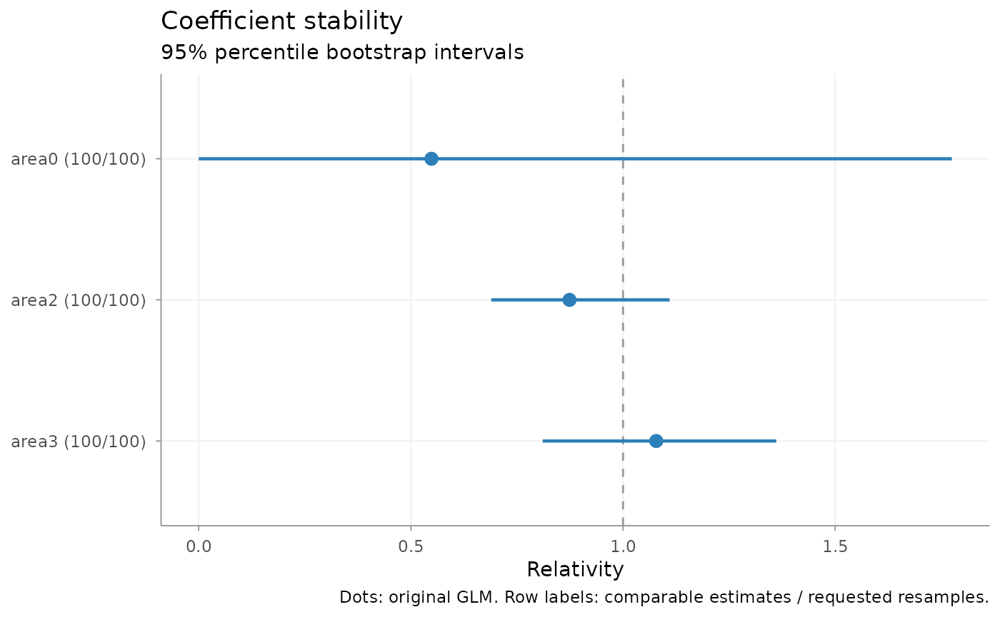
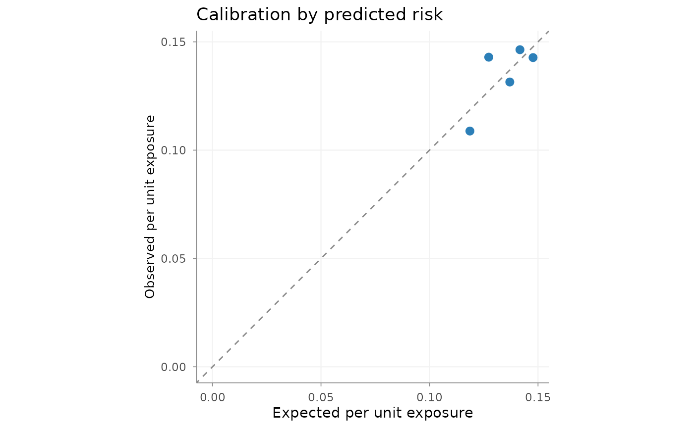
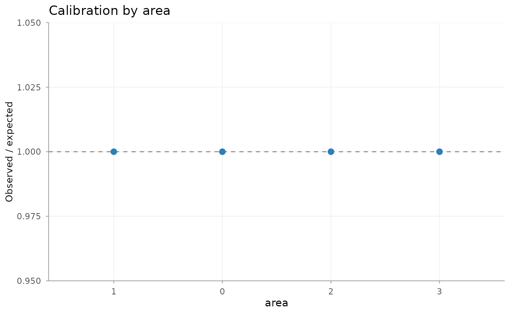

# Model validation

## What does model validation mean?

Validation of an insurance pricing model is broader than comparing fit
statistics. A model may describe the estimation data well while
producing unstable, weakly supported or actuarially implausible tariff
relativities. Conversely, a statistically detectable imperfection may
have little practical pricing effect in the insured portfolio.

No single metric determines whether a model is adequate. A validation
review normally combines several dimensions:

| Dimension | Practical question |
|----|----|
| Statistical adequacy | Are the model structure and distribution broadly consistent with the data? |
| Predictive performance | How well does the model predict the relevant outcome, preferably outside the estimation sample where appropriate? |
| Stability | How sensitive are estimates or performance to variation in the observed sample? |
| Tariff plausibility | Are the effects interpretable, credible and suitable for the intended tariff? |
| Portfolio behaviour | Where does expected experience differ systematically from observed experience? |

These dimensions are complementary rather than a mandatory sequence.
Their relative importance depends on the response, portfolio, modelling
objective and intended use of the tariff.

This vignette starts from fitted models. [Getting
Started](https://mharinga.github.io/insurancerating/articles/getting-started.md)
provides the worked modelling example, while [Pricing workflow and
package building
blocks](https://mharinga.github.io/insurancerating/articles/pricing-workflow-building-blocks.md)
maps validation within the wider package. Jump to the [quick
start](#quick-start) for runnable examples.

## Validation map

The following functions support different validation questions. Not
every model requires every diagnostic.

| Validation question | Typical tool |
|----|----|
| How do alternative fitted models compare? | [`model_performance()`](https://mharinga.github.io/insurancerating/reference/model_performance.md) |
| Are tariff relativities plausible and sufficiently supported? | [`rating_table()`](https://mharinga.github.io/insurancerating/reference/rating_table.md) |
| Does marginal observed experience support the fitted pattern? | [`add_factor_experience()`](https://mharinga.github.io/insurancerating/reference/add_factor_experience.md) |
| How sensitive is measured performance to portfolio resampling? | [`validate_performance()`](https://mharinga.github.io/insurancerating/reference/validate_performance.md) |
| How sensitive are the fitted coefficients to portfolio resampling? | [`coefficient_stability()`](https://mharinga.github.io/insurancerating/reference/coefficient_stability.md) |
| Is a Poisson frequency model materially overdispersed? | [`check_overdispersion()`](https://mharinga.github.io/insurancerating/reference/check_overdispersion.md) |
| Do simulation-based residuals show remaining structure? | [`check_residuals()`](https://mharinga.github.io/insurancerating/reference/check_residuals.md) |
| Where does the model over- or under-predict? | [`calibration_analysis()`](https://mharinga.github.io/insurancerating/reference/calibration_analysis.md) |

## Compact example setup

Most examples use two Poisson frequency models fitted to the same
records, response and exposure definition. Each prediction is an
expected claim count for the observed policy period because it includes
the earned-exposure offset.

``` r

library(insurancerating)

portfolio <- as.data.frame(MTPL2)
portfolio$area <- factor(portfolio$area)
portfolio$area <- set_reference_level(portfolio$area, portfolio$exposure)

intercept_model <- glm(
  nclaims ~ 1 + offset(log(exposure)),
  family = poisson(),
  data = portfolio
)

area_model <- glm(
  nclaims ~ area + offset(log(exposure)),
  family = poisson(),
  data = portfolio
)
```

The fitted model is starting material here; construction of frequency,
severity and technical risk-premium models is covered elsewhere.

## Quick start

Each call answers a different question about the fitted frequency
models. The diagnostics can be used independently.

``` r

# Compare models fitted on the same records.
fit_comparison <- model_performance(intercept_model, area_model)

# Does one common rate predict the right total in each area?
area_check <- calibration_analysis(intercept_model, portfolio, by = "area")

# How much does prediction error vary on rows left out of each refit?
set.seed(123)
resample_result <- validate_performance(
  area_model, portfolio, sampling = "bootstrap", sample_fraction = 0.8,
  n_resamples = 50, metrics = c("rmse", "mae", "deviance"),
  show_progress = FALSE
)

# Is the response distribution consistent with the fitted model?
residual_check <- check_residuals(area_model, n_simulations = 250)
```

`area_check` compares observed and expected **counts**, with exposure
for context. A value of O/E above one means the model predicted too few
claims. Here this is a check on the estimation portfolio, not an
independent test.

``` r

area_check
#>   area Observed   Expected        OE    N   Exposure
#> 1    1      146 143.295924 1.0188706 1194 1065.74795
#> 2    0        1   1.789182 0.5589146   15   13.30685
#> 3    2       98 110.057361 0.8904448  921  818.53973
#> 4    3      113 102.857533 1.0986069  870  764.99178
```

The [resampling plot](#assessing-resampling-stability) and [residual
plot](#simulation-based-residuals) show how to inspect the other
results. For sampling variation in individual tariff effects, see
[coefficient stability](#how-stable-are-the-tariff-relativities).

## Comparing model performance

``` r

fit_comparison
#> # Comparison of Model Performance Indices
#> 
#>      Model      |   AIC    |   BIC    | RMSE  | Residual_Deviance 
#> ----------------+----------+----------+-------+------------------ 
#> intercept_model | 2284.056 | 2290.063 | 0.356 |          1608.352 
#>      area_model |  2287.25 | 2311.275 | 0.356 |          1605.545
```

[`model_performance()`](https://mharinga.github.io/insurancerating/reference/model_performance.md)
reports AIC, BIC, response-scale RMSE and residual deviance:

- AIC and BIC compare likelihood fit while penalising model complexity;
- residual deviance describes the remaining lack of fit on the
  estimation data;
- RMSE summarises prediction error in the response unit and gives
  relatively high weight to large errors because it squares them. The
  RMSE itself is unweighted. Here the response unit is claim count, not
  claims per unit exposure.

These values are most directly comparable when models use the same
response, estimation records, weights and offsets, as they do here.
Residual deviances should also be compared within the same model family.
RMSE uses only the rows retained in the fit. None of these values
establishes performance on a future portfolio.

Lower values can support a model comparison, but a small improvement
does not automatically imply a better tariff. Exposure by level,
coefficient stability, residual behaviour, observed experience and
practical interpretability remain part of the assessment.

## Inspecting tariff structure and observed experience

[`rating_table()`](https://mharinga.github.io/insurancerating/reference/rating_table.md)
expresses fitted GLM effects as tariff relativities and shows the
exposure supporting each level. This makes the statistical output easier
to review in actuarial terms. Observed experience can be attached to the
same table for a direct graphical comparison.

For this comparison, use `MTPL`, which also contains policyholder age.
The model estimates regional effects at the same age, while the observed
frequency reflects each region’s actual mix of ages.

``` r

tariff_portfolio <- as.data.frame(MTPL)
tariff_portfolio$zip <- set_reference_level(
  factor(tariff_portfolio$zip), tariff_portfolio$exposure
)

tariff_model <- glm(
  nclaims ~ zip + age_policyholder + offset(log(exposure)),
  family = poisson(), data = tariff_portfolio
)

tariff_table <- rating_table(
  "Age-adjusted model" = tariff_model,
  model_data = tariff_portfolio,
  exposure = "exposure"
)

tariff_table
#>        risk_factor            level est_Age-adjusted model exposure
#> 1      (Intercept)      (Intercept)              0.3121503       NA
#> 2              zip                0              1.0006508      207
#> 3              zip                1              1.0000000    11081
#> 4              zip                2              0.9020158     7783
#> 5              zip                3              0.9559945     7588
#> 6 age_policyholder age_policyholder              0.9831025       NA

tariff_review <- tariff_table |>
  add_factor_experience(
    data = tariff_portfolio,
    risk_factors = "zip",
    claim_count = "nclaims",
    exposure = "exposure",
    metric = "frequency",
    label = "Observed frequency"
  )

autoplot(
  tariff_review,
  risk_factors = "zip",
  metric = "frequency"
)
```


A model with slightly better aggregate fit can still be unattractive
when it creates volatile neighbouring relativities, extreme effects
supported by little exposure or shapes without a plausible risk
interpretation. An extreme coefficient in a small segment should
therefore not be interpreted in the same way as the same coefficient
supported by a substantial share of the portfolio.

For region 0, the observed frequency is about 2.5% below the reference
region’s frequency, while the fitted model estimates almost no
difference at the same age. Region 0 also has relatively little
exposure. The gap is a reason to look at the age mix and claim volume,
not evidence by itself of poor calibration. Use
[`calibration_analysis()`](https://mharinga.github.io/insurancerating/reference/calibration_analysis.md)
to compare full-model predictions with actual outcomes.

## Assessing resampling stability

Unlike
[`model_performance()`](https://mharinga.github.io/insurancerating/reference/model_performance.md),
[`validate_performance()`](https://mharinga.github.io/insurancerating/reference/validate_performance.md)
refits the model for each sample. Choose the evaluation rows according
to the question:

| Setting | Rows used to score each refit |
|----|----|
| Default bootstrap: `sample_fraction = 1` | The same sample used for fitting |
| Bootstrap: `sample_fraction < 1` | Rows not used in that fit (out of bag) |
| Random split: `sample_fraction < 1` | Rows held out of the training split |
| Rolling validation | Subsequent periods, after the training window |

The quick start uses out-of-bag evaluation. The plot subtitle identifies
the evaluation rows used.

``` r

head(resample_result$scores)
#>        rmse       mae deviance
#> 1 0.3436239 0.2051759 708.7991
#> 2 0.3715056 0.2115858 746.2368
#> 3 0.3766939 0.2101049 785.8242
#> 4 0.3584633 0.2047888 761.8024
#> 5 0.3542650 0.2069595 716.3567
#> 6 0.3422794 0.2106021 687.1987
autoplot(resample_result, metric = "rmse")
```


Here, `sample_fraction = 0.8` means 80 draws per 100 rows, **with
replacement**. Some rows can be drawn more than once. The model is
scored on rows not used for training (the *out-of-bag* rows), not on a
fixed 20% test set. With `sampling = "split"` and a fraction below 1,
the draw is without replacement and the remaining rows are held out.

RMSE and MAE measure error in claim counts here. The dashed orange line
is the original model’s RMSE on the full supplied portfolio, not on the
out-of-bag rows used for the histogram. The table also reports
predictive deviance: the same calculation as residual deviance, applied
to the evaluation rows and their predictions. Total deviance depends on
the number and weight of those rows as well as prediction quality.

A wide spread of scores may reflect differences between refitted models,
differences in the claim mix of the evaluation samples, or both. Use
[`coefficient_stability()`](https://mharinga.github.io/insurancerating/reference/coefficient_stability.md)
to examine the fitted effects themselves. Evaluation on out-of-bag or
split rows is out of sample for each refit, but does not replace
validation on a later or external portfolio.

### How stable are the tariff relativities?

[`coefficient_stability()`](https://mharinga.github.io/insurancerating/reference/coefficient_stability.md)
draws rows with replacement from the estimation portfolio and refits the
GLM. It summarises the fitted effects, not prediction errors. For this
log-link model, `scale = "relativity"` expresses each area effect as a
ratio to the original reference area.

``` r

area_stability <- coefficient_stability(
  area_model, n_resamples = 100, seed = 123, show_progress = FALSE
)
autoplot(area_stability, scale = "relativity")
```



The dots are original GLM estimates, the bars are bootstrap intervals,
and the dashed line at 1 marks no relative effect. The counts next to
each term show how many of the requested resamples yield comparable
estimates for that effect. Use
`summary(area_stability, scale = "relativity")` to inspect the numbers.
A refit can converge without yielding a comparable estimate for every
level, for example when a reference level is absent from the draw. A
narrow interval based on few usable draws offers little reassurance.
Area 0 has about 13 policy-years and one claim in the estimation
portfolio, so interpret its interval with that limited experience in
mind.

This is a row bootstrap, not a policy bootstrap. If one policy
contributes several records, drawing them independently can understate
uncertainty. When that dependence matters, a cluster bootstrap would
draw whole policies and retain their records together.
[`coefficient_stability()`](https://mharinga.github.io/insurancerating/reference/coefficient_stability.md)
does not currently implement that design.

## Testing on later periods

Rolling validation fits the specification on earlier periods and scores
it on the next period or periods. The training window expands one period
at a time. This example simulates policy periods with a higher claim
frequency from 2023 onwards, so the first evaluation window faces a
change in level.

``` r

set.seed(123)
temporal_data <- data.frame(
  year = rep(2020:2025, each = 250),
  exposure = rep(c(0.5, 1), 750)
)
temporal_data$nclaims <- with(
  temporal_data,
  rpois(nrow(temporal_data), exposure * ifelse(year < 2023, 0.10, 0.20))
)
temporal_model <- glm(
  nclaims ~ 1 + offset(log(exposure)),
  family = poisson(), data = temporal_data
)
validate_performance(
  temporal_model, temporal_data, sampling = "rolling", time = "year",
  initial = 3, metrics = c("rmse", "mae", "deviance"), show_progress = FALSE
)
#>   iteration train_start train_end test_start test_end n_train n_test      rmse
#> 1         1        2020      2022       2023     2023     750    250 0.3297975
#> 2         2        2020      2023       2024     2024    1000    250 0.3843832
#> 3         3        2020      2024       2025     2025    1250    250 0.3968839
#>         mae deviance
#> 1 0.1689067 130.2780
#> 2 0.1866373 139.2036
#> 3 0.2028800 148.2633
```

The first fit uses 2020 to 2022 and scores 2023. The next fit adds 2023
to training and scores 2024. Unlike plotting calibration by year for a
fixed model, each fit uses only the information available in its
training window.

## Checking distributional assumptions

### Overdispersion

``` r

dispersion_check <- check_overdispersion(area_model)
dispersion_check
#> Dispersion ratio =    1.220
#> Pearson's Chi-squared = 3655.711
#> p-value =  < 0.001
#> Overdispersion detected.
```

For a Poisson frequency GLM, the dispersion ratio is Pearson’s
chi-squared statistic divided by the residual degrees of freedom. A
value above one means that observed variation exceeds the variance
implied by the Poisson model. Here the ratio is about 1.22. It is a
diagnostic of extra variation, not a factor to apply to premiums.

Both statistical evidence and practical magnitude matter. In a large
insurance portfolio, a small departure can produce a very small p-value
simply because many observations are available. The size of the
dispersion ratio and its effect on uncertainty and tariff decisions are
generally more informative than the p-value alone. Overdispersion can
indicate omitted heterogeneity, clustering, unusual observations or
model misspecification, but does not by itself identify the cause.

### Simulation-based residuals

``` r

autoplot(residual_check)
#> Residuals consistent with expected distribution (p = 0.656)
```



[`check_residuals()`](https://mharinga.github.io/insurancerating/reference/check_residuals.md)
uses DHARMa simulations from the fitted model to construct scaled
residuals. The QQ plot and uniformity test assess whether the observed
response behaves consistently with the distribution implied by that
model.

The QQ plot can flag a distributional mismatch but does not identify the
predictor or segment involved. A separate plot against fitted values,
exposure or a rating factor can help locate a pattern. The uniformity
p-value is a diagnostic signal, not a stand-alone acceptance rule.

## Reviewing observed versus expected experience

Use
[`calibration_analysis()`](https://mharinga.github.io/insurancerating/reference/calibration_analysis.md)
to compare observed and expected outcomes overall and within segments.
Here the predictions include earned exposure, so both totals are claim
counts.

``` r

calibration_analysis(area_model, portfolio)
#>   Observed Expected OE    N Exposure
#> 1      358      358  1 3000 2662.586
area_calibration <- calibration_analysis(area_model, portfolio, by = "area")
area_calibration
#>   area Observed Expected OE    N   Exposure
#> 1    1      146      146  1 1194 1065.74795
#> 2    0        1        1  1   15   13.30685
#> 3    2       98       98  1  921  818.53973
#> 4    3      113      113  1  870  764.99178
autoplot(area_calibration)
```



O/E is observed claims divided by expected claims. A ratio above 1 means
more claims were observed than expected; a ratio below 1 means fewer.
The overall ratio describes calibration-in-the-large.

Here, O/E is 1 in every area: the Poisson model estimates a separate
rate for each area and is evaluated on the same records used to fit it.
This illustrates how to read the output, but does not demonstrate
calibration on new data.

Use `by = "year"` when the evaluation data contain a calendar year. A
change in O/E across years can indicate a change in the overall
prediction level, even if the model still ranks high- and low-risk
policies equally well.
[`autoplot()`](https://ggplot2.tidyverse.org/reference/autoplot.html)
shows that comparison as an O/E line over time. To check whether the
pattern differs by area, use `by = c("year", "area")`. This gives one
row per observed year and area combination, with their exposure and
claim totals. The plot shows a point per combination rather than joining
areas into a single time series.

### Does the model get claim frequency right at different risk levels?

For this example, reserve part of the MTPL portfolio and fit a frequency
model using age and ZIP on the remaining rows. The row split illustrates
evaluation on data not used in the fit; it is not a test on a later
year.

With `groups = 5`, the function sorts policy records from lowest to
highest **predicted claims per policy-year**. Dividing each prediction
by its exposure for this ranking means a longer policy period is not
treated as a higher risk just because more claims are expected during
it.

The sorted records are split into five groups. Group 1 contains the
lowest predicted risks and group 5 the highest. Each group aims for
about 20% of the portfolio’s total exposure, not 20% of the policies.
These are groups of model predictions, not rating-factor levels such as
area. Policies with the same predicted frequency can fall on either side
of a group boundary; ties follow the input row order.

``` r

set.seed(123)
train <- sample.int(nrow(tariff_portfolio), floor(0.7 * nrow(tariff_portfolio)))
risk_model <- glm(
  nclaims ~ age_policyholder + zip + offset(log(exposure)),
  family = poisson(), data = tariff_portfolio[train, ]
)
risk_calibration <- calibration_analysis(
  risk_model, tariff_portfolio[-train, ], groups = 5
)
knitr::kable(risk_calibration, digits = 2)
```

| Group | Observed | Expected |   OE |    N | Exposure |
|------:|---------:|---------:|-----:|-----:|---------:|
|     1 |      154 |   147.18 | 1.05 | 1728 |  1597.47 |
|     2 |      190 |   186.30 | 1.02 | 1767 |  1597.88 |
|     3 |      192 |   218.70 | 0.88 | 1801 |  1597.85 |
|     4 |      227 |   253.48 | 0.90 | 1854 |  1598.29 |
|     5 |      314 |   301.17 | 1.04 | 1850 |  1597.70 |

``` r

autoplot(risk_calibration)
```


Each dot is one group. Its x-coordinate is total expected claims divided
by the group’s total policy-years; its y-coordinate is total observed
claims divided by the same policy-years. Group 3 (the middle dot) has
192 observed claims versus about 219 expected. A dot below the diagonal
means the model predicted too many claims for that group; a dot above it
means the model predicted too few.

This is a visual check for systematic over- or under-prediction, not a
statistical test or a measure of how well the model ranks individual
risks. Read a gap alongside the group’s exposure and claim volume: a
large O/E deviation based on few claims may have little credibility. If
multiple rows describe the same policy, keep them together when forming
a holdout.

## Validation, investigation and refinement

### Comparing expected claims before and after refinement

For a model returned by
[`refit()`](https://mharinga.github.io/insurancerating/reference/refit.md),
the original portfolio may not contain the columns added by smoothing or
restrictions. To check the refit’s own portfolio, use
`extract_model_data(refined_model)`. For a smoothed model, group by the
column containing the new tariff bands (for example, `by = "age_smooth"`
if the source variable was `age`), rather than by the numeric relativity
column used in the offset. On separate evaluation data, apply the same
refinement mappings to those rows first.

To check a restriction, put **observed claims, expected claims before
and expected claims after** side by side. Use the same records and the
same grouping column for both models so that any change comes from the
predictions rather than a change in portfolio mix.

``` r

restricted_model <- prepare_refinement(area_model, data = portfolio) |>
  add_restriction(c("3" = 1.10), model_variable = "area") |>
  refit()

evaluation <- extract_model_data(restricted_model)
before <- calibration_analysis(area_model, evaluation, by = "area")
after <- calibration_analysis(restricted_model, evaluation, by = "area")

comparison <- merge(
  before[c("area", "Exposure", "Observed", "Expected")],
  after[c("area", "Expected")],
  by = "area",
  suffixes = c("_before", "_after")
)
knitr::kable(comparison, digits = 2)
```

| area | Exposure | Observed | Expected_before | Expected_after |
|:-----|---------:|---------:|----------------:|---------------:|
| 0    |    13.31 |        1 |               1 |           0.99 |
| 1    |  1065.75 |      146 |             146 |         145.08 |
| 2    |   818.54 |       98 |              98 |          97.38 |
| 3    |   764.99 |      113 |             113 |         114.55 |

Use fixed bands or rating-factor levels for this comparison. With
`groups = 5`, each model can rank policies differently, so its group 1
need not contain the same policies as group 1 from the other model. This
is a comparison of two sets of predictions on the same portfolio, not
evidence that the restriction improves predictions on new data.

### Acting on validation findings

Validation identifies evidence; it should not silently alter the model.
A useful response to an issue is:

1.  identify the affected observations or tariff levels;
2.  investigate the likely cause;
3.  revise the data or model when the statistical specification is
    responsible;
4.  apply an explicit actuarial refinement only when it has a defensible
    tariff rationale;
5.  validate the resulting model again.

Incorrect exposure, data-quality problems, missing interactions, poor
segmentation, inappropriate distributions and large-loss treatment can
all produce unattractive diagnostics. These issues may require
revisiting the model rather than smoothing or restricting its
coefficients. The [Refinement building
blocks](https://mharinga.github.io/insurancerating/articles/refinement-workflow.md)
vignette explains how justified tariff adjustments can be recorded and
refitted explicitly.

## Putting the evidence together

Validation should combine evidence rather than rank models on one
metric. A model may have a slightly lower AIC but unstable coefficients,
weak observed support and material residual structure. Such a model may
be less suitable for tariff implementation than a more stable
alternative.

Conversely, a statistically significant diagnostic result may have
little practical effect when its magnitude is small and portfolio
behaviour remains stable. The conclusion should reflect statistical
adequacy, predictive evidence, sampling stability, exposure and
credibility, actuarial plausibility and the intended pricing use.

## Where to go next

- [Getting
  Started](https://mharinga.github.io/insurancerating/articles/getting-started.md)
  constructs and interprets a pricing model in one worked example.
- [Pricing workflow and package building
  blocks](https://mharinga.github.io/insurancerating/articles/pricing-workflow-building-blocks.md)
  maps the complete package architecture.
- [Refinement building
  blocks](https://mharinga.github.io/insurancerating/articles/refinement-workflow.md)
  translates identified tariff issues into explicit, reviewable
  adjustments.
- [Large
  Portfolios](https://mharinga.github.io/insurancerating/articles/large-portfolios.md)
  covers model-point aggregation and database-backed reduction.
