# From statistical model to insurance tariff: a motor insurance case study

A motor insurer is reviewing its expected claims cost. The fitted model
gives different rates for neighbouring vehicle-value bands, and some
geographic relativities are based on very few claims. Can a smoother
tariff retain useful risk differences without materially changing the
risk premium for many policies?

This is one way to combine the package’s building blocks. The target is
**technical risk premium** (expected claims cost), before expenses,
margin, taxes or commercial adjustments.

## Portfolio experience

The bundled motor data illustrate individual analyses but do not contain
the policy histories and periods needed here. This portfolio is
synthetic. Some policies recur and share a policy-level risk effect.
Vehicle value is associated with fuel type and vehicle age. Claim
frequency rises faster above 45,000 in vehicle value. Claim amounts are
right skewed. Later years have higher claim costs and a shift in one
region’s frequency. The candidate tariff is not part of the
data-generating process.

Reproduce the synthetic portfolio

``` r

set.seed(1204)
n <- 850
policies <- data.frame(
  policy_id = seq_len(n),
  driver_age = sample(20:75, n, replace = TRUE),
  vehicle_age = sample(0:16, n, replace = TRUE),
  fuel = factor(sample(c("Petrol", "Hybrid", "Electric"), n, TRUE,
                       prob = c(.70, .20, .10))),
  region = factor(sample(c("Urban", "Suburban", "Rural", "Island"), n, TRUE,
                         prob = c(.45, .32, .20, .03)),
                  levels = c("Urban", "Suburban", "Rural", "Island")),
  bonus = factor(sample(1:4, n, TRUE), levels = 1:4),
  latent_risk = rnorm(n, sd = .27)
)
policies <- policies |>
  mutate(vehicle_value = round(pmin(73500, pmax(1500,
    rlnorm(n(), log(28500), .52) - 950 * vehicle_age + 10500 * (fuel != "Petrol")
  ))))

motor <- bind_rows(lapply(2020:2025, function(calendar_year) {
  policies |>
    filter(runif(n()) < .86) |>
    mutate(
      year = calendar_year,
      driver_age = driver_age + year - 2020,
      vehicle_age = vehicle_age + year - 2020,
      exposure = runif(n(), .15, 1),
      frequency = exp(-2.2 + .00055 * (driver_age - 47)^2 +
        .50 * log1p(vehicle_value / 20000) +
        1.10 * (pmax(vehicle_value - 45000, 0) / 30000)^2 -
        .15 * as.integer(bonus) + .25 * (region == "Island") -
        .15 * (region == "Rural") +
        .32 * (region == "Suburban" & year >= 2023) + latent_risk),
      nclaims = rpois(n(), exposure * frequency),
      cost = 1550 * (1 + vehicle_value / 58000) * 1.05^(year - 2020),
      amount = rgamma(n(), shape = 1.25 * nclaims, scale = cost / 1.25)
    ) |>
    select(-latent_risk, -frequency, -cost)
}))

train <- filter(motor, year < 2025)
# Do not use 2025 outcomes to choose models, bands or adjustments.
```

Is an area’s high risk premium driven by many claims or expensive
claims? Compare claims per exposure-year, average cost per claim and
total claims cost per exposure-year. Read the rates alongside exposure,
especially for Island. These are marginal summaries; the mix of cars and
drivers can differ by area.

``` r

area <- factor_analysis(train, risk_factors = "region", claim_count = "nclaims",
                        claim_amount = "amount", exposure = "exposure")
autoplot(area, metrics = c("frequency", "average_severity", "risk_premium"),
         decimal_mark = ".")
```

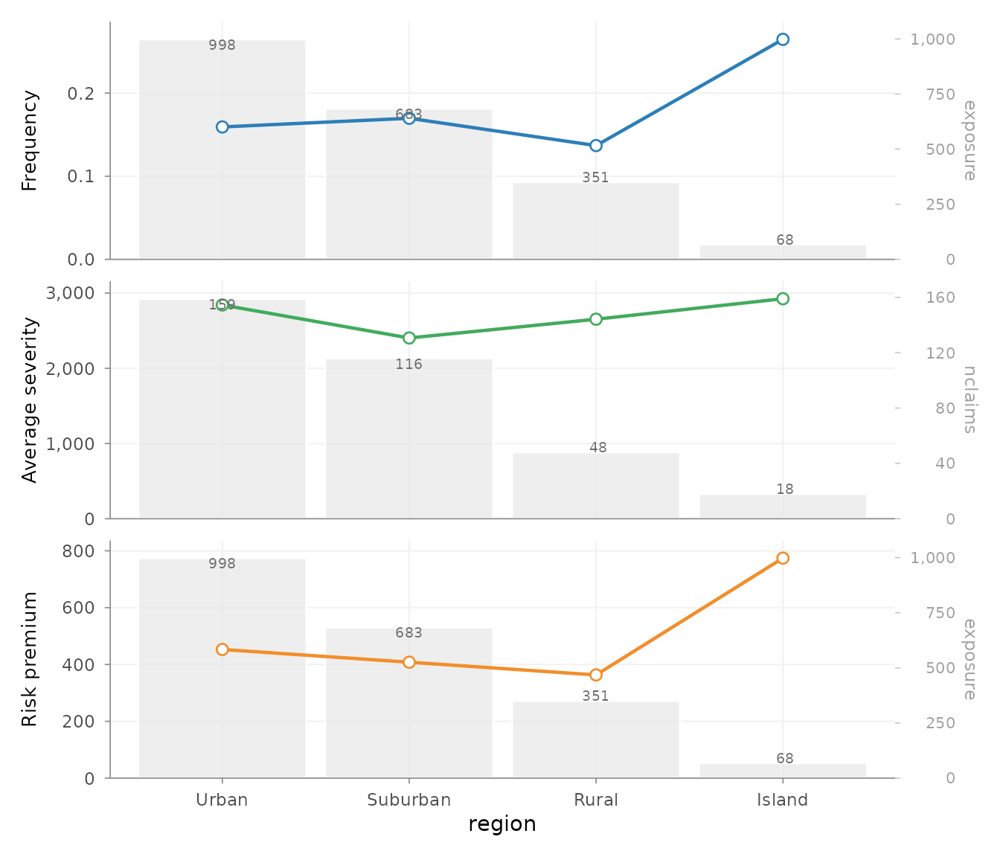

A few large losses can pull the mean far above the median. The severity
plot uses only periods with exactly one claim, so each point is an
individual claim amount, rather than a total for several claims. It
describes that subset only. The orange circle marks the mean and the
blue diamond marks the median.

``` r

plot_severity_distribution(
  data = filter(train, nclaims == 1),
  claim_amount = "amount",
  all_claims_label = "Single-claim periods",
  x_label = "Claim amount",
  point_method = "quasirandom"
)
```

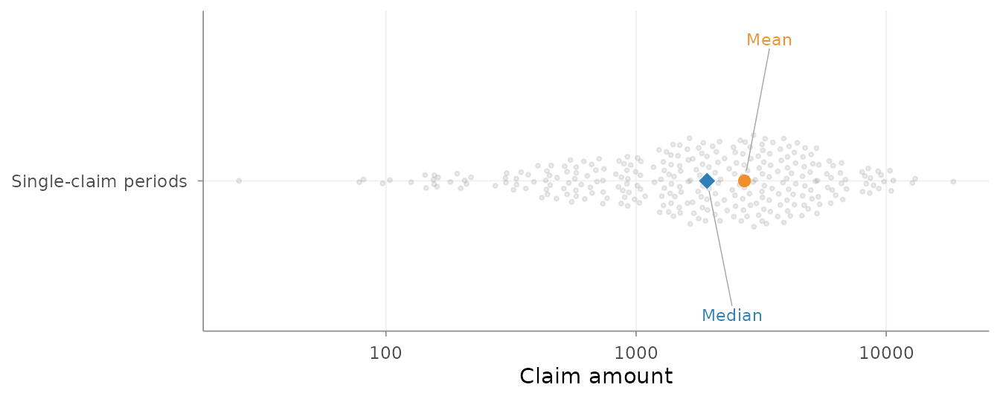

## Vehicle value and the initial models

Is the relationship with vehicle value continuous, or do a few bands
describe it adequately? A marginal frequency GAM can help find a
candidate set of bands. It is not the adjusted vehicle-value effect.
Round vehicle values to the nearest 2,500 before pooling claims and
exposure and fitting the GAM. Each dot shows the observed claim
frequency at a rounded value. The curve shows the fitted frequency, and
the vertical lines mark the derived segment boundaries.

``` r

value_gam <- risk_factor_gam(
  train,
  risk_factor = "vehicle_value",
  claim_count = "nclaims",
  exposure = "exposure",
  round_risk_factor = 2500
)
value_segments <- derive_tariff_segments(value_gam, segmentation_penalty = 8,
                                        seed = 1205, max_iterations = 500,
                                        population_size = 60)
autoplot(value_segments, show_observations = TRUE) +
  labs(x = "Vehicle value", y = "Claims per exposure-year")
```

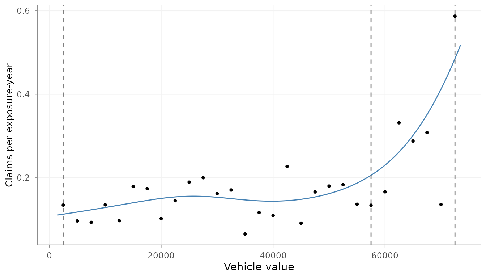

The fitted frequency rises more steeply in the upper range, where the
candidate split separates the highest values. Use
[`add_tariff_segments()`](https://mharinga.github.io/insurancerating/reference/add_tariff_segments.md)
to add the derived bands to the portfolio. Here they are an exploratory
alternative. The models use pre-specified rounded bands, so each
historical validation window can use the same definitions without
learning them from later years.

``` r

train <- add_tariff_segments(train, value_segments, name = "value_segment")
count(train, value_segment)
#>         value_segment    n
#> 1  [2.5e+03,5.75e+04] 3383
#> 2 (5.75e+04,7.25e+04]  259
```

``` r

value_breaks <- c(0, 7500, 15000, 25000, 35000, 50000, 75000)
add_model_bands <- function(data) {
  data |>
    mutate(
      value_band = cut(vehicle_value, value_breaks, include.lowest = TRUE, dig.lab = 8),
      driver_band = cut(driver_age, c(0, 30, 45, 60, 100))
    )
}
train <- add_model_bands(train)
```

The frequency model predicts **claim counts** over each policy period,
because the formula contains a log-exposure offset. Dividing by exposure
gives an annualised frequency. The severity model predicts mean cost per
claim and weights a policy period by its number of claims. Multiplying
the two model predictions gives expected loss over the period.
Discretising continuous predictors is useful if the result needs to be
delivered as a rate table; it is not a requirement for statistical
modelling.

``` r

frequency <- glm(
  nclaims ~ value_band + driver_band + bonus + region + fuel + offset(log(exposure)),
  family = poisson(), data = train
)
with_claims <- filter(train, nclaims > 0)
severity <- glm(
  I(amount / nclaims) ~ value_band + fuel,
  family = Gamma(link = "log"), weights = nclaims, data = with_claims
)
model_performance(frequency, metrics = c("gini", "normalized_gini"))
#> # Comparison of Model Performance Indices
#> 
#>   Model   |   AIC    |   BIC    | RMSE  | Residual_Deviance | Gini  | Normalized_Gini 
#> ----------+----------+----------+-------+-------------------+-------+---------------- 
#> frequency | 2252.358 | 2357.763 | 0.309 |          1571.251 | 0.206 |           0.223
```

## Which fitted effects are stable?

Compare the adjusted frequency relativities with the observed marginal
relativities. Both are relative to the reference level, but the observed
series does not adjust for the other predictors. A gap is a reason to
check portfolio composition, not by itself a model defect.

``` r

region_table <- rating_table(frequency, exposure = FALSE) |>
  add_factor_experience(data = train, exposure = "exposure", claim_count = "nclaims")
autoplot(region_table, risk_factor = "region")
```

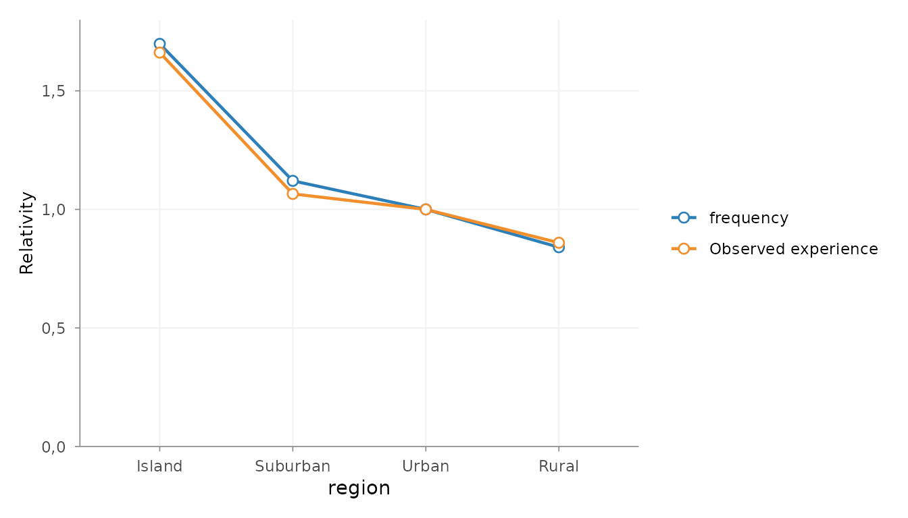

The row bootstrap asks how sensitive the geographic terms are to a
different sample from these records. It does not account for dependence
between records of a policy. The separate annual fits ask whether the
same geographic contrasts look similar across years. Read both alongside
exposure and intervals. Neither proves that a region’s underlying risk
has changed.

``` r

boot <- coefficient_stability(frequency, n_resamples = 60, seed = 1206,
                              show_progress = FALSE)
periods <- coefficient_stability(frequency, method = "period", period = "year")
region_terms <- grep("^region", names(coef(frequency)), value = TRUE)
filter(summary(boot), term %in% region_terms)
#>             term   estimate bootstrap_mean        bias bootstrap_se       lower
#> 1 regionSuburban  0.1137485     0.09867867 -0.01506984    0.1177667 -0.10655075
#> 2    regionRural -0.1738609    -0.16821496  0.00564591    0.1633957 -0.48336881
#> 3   regionIsland  0.5295253     0.45464826 -0.07487707    0.2142077  0.03051817
#>       upper n_successful n_requested success_rate
#> 1 0.2896742           60          60            1
#> 2 0.1875925           60          60            1
#> 3 0.7947666           60          60            1

island_experience <- train |>
  filter(region == "Island") |>
  summarise(nclaims = sum(nclaims), exposure = sum(exposure), .by = year)
island_fits <- periods$estimates |>
  filter(term == "regionIsland") |>
  select(year = period, relativity)
left_join(island_experience, island_fits, by = "year")
#>   year nclaims exposure relativity
#> 1 2020       2 14.67616  1.2340566
#> 2 2021       5 14.14139  1.7724956
#> 3 2022       7 14.46513  3.4091141
#> 4 2023       2 13.10706  1.1594607
#> 5 2024       2 11.61269  0.7568541

autoplot(periods, terms = "regionSuburban", scale = "relativity") +
  labs(title = "Suburban relative to Urban", colour = NULL) +
  guides(colour = "none")
```

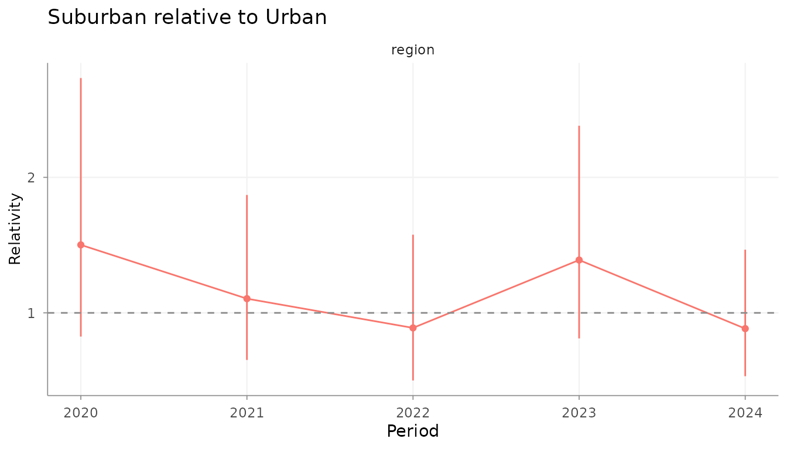

Across the five training years, Island records only 18 claims. Read the
annual Island estimates alongside the local exposure and claim counts.
The plot asks a different question: does the Suburban frequency effect,
relative to Urban, look stable from year to year? The dashed line at 1
means no difference. Read apparent shifts alongside the intervals before
treating them as lasting changes.

## A candidate frequency tariff

Suppose vehicle value should not reduce claim frequency in this tariff.
An increasing smoothing allows flat sections but not a drop as vehicle
value rises. The proposed bands keep their original boundaries. This
shape is an illustrative choice, not a general rule for motor insurance.

``` r

proposal <- frequency |>
  prepare_refinement(data = train) |>
  add_smoothing("value_band", "vehicle_value", breaks = value_breaks,
                smoothing = "increasing", k = 5, weights = "exposure")
autoplot(proposal)
```

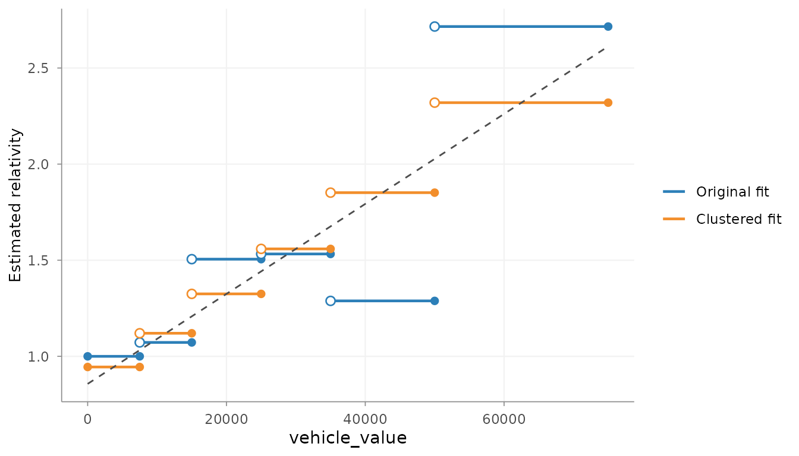

``` r


value_only <- refit(proposal, intercept_only = TRUE)
```

For a second candidate, suppose additional information supports a small
increase at higher vehicle values. Compare the edited curve with the
original smoothing: the adjustment starts at 35,000 and builds towards
the upper end.

``` r

edited <- proposal |>
  edit_smoothing(model_variable = "value_band", from = 35000, adjustment = 1.02,
                 transition = "linear")
autoplot(edited, variable = "value_band", show_initial_smoothing = TRUE)
```

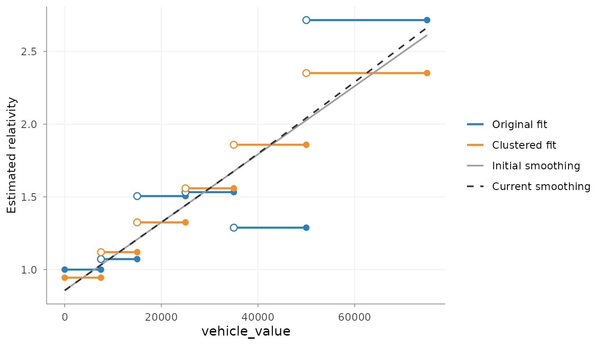

Suppose also that a higher bonus level should not increase frequency.
The fitted relativities already decrease in this example, so the two
lines overlap: the monotonicity check does not require a change.

``` r

ordered_bonus <- edited |>
  add_monotonicity("bonus", direction = "decreasing", weights = "exposure")
autoplot(ordered_bonus, variable = "bonus")
```

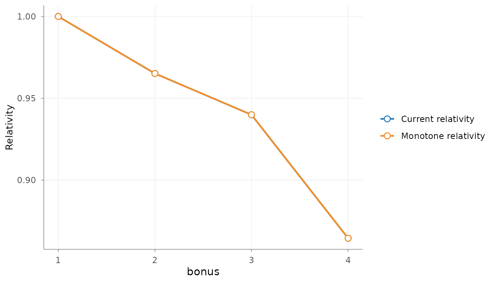

To reduce regional differences, shrink the regional log-relativities
towards a common centre with the same credibility weight for each
region.

``` r

combined <- ordered_bonus |>
  add_shrinkage("region", credibility = .75, weights = "exposure")
autoplot(combined, variable = "region")
```

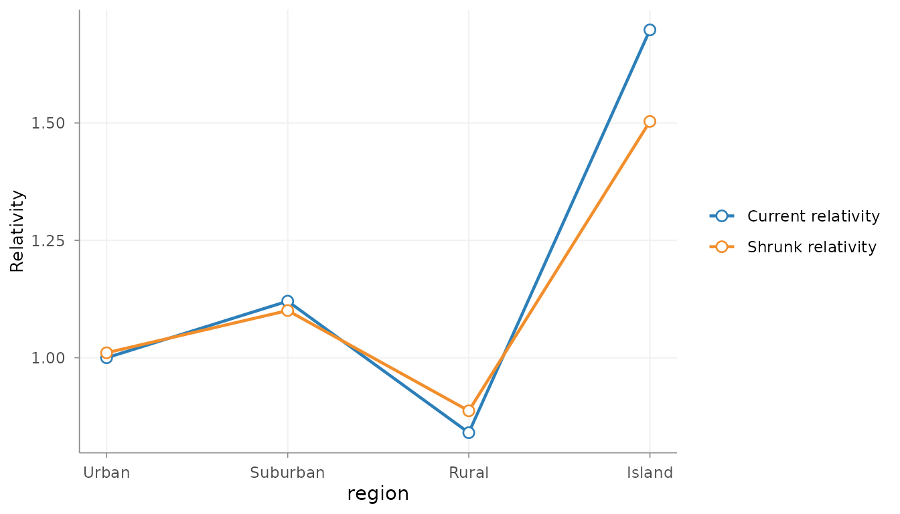

``` r


candidate <- refit(combined, intercept_only = TRUE)
```

Before reviewing individual changes, align the two models’ total
expected loss on the training portfolio. This keeps the audit focused on
how the risk premium is redistributed.

Align the expected loss level on the training portfolio

``` r

pricing <- extract_model_data(candidate) |>
  add_prediction(frequency, candidate, severity,
                 predictions = c("original", "candidate", "severity")) |>
  mutate(original_loss = original * severity, candidate_loss = candidate * severity)
level <- pricing |>
  summarise(factor = sum(original_loss) / sum(candidate_loss)) |>
  pull(factor)
candidate <- adjust_intercept(candidate, factor = level)
```

## Who would see a change?

Audit the combined candidate on the original training portfolio. A small
portfolio change can hide sizeable increases and decreases for
individual records. Because severity and exposure are held fixed, each
record’s percentage change in expected claims cost is also its
percentage change in predicted frequency. The portfolio’s aggregate
frequency need not be identical after aligning aggregate expected
losses.

``` r

impact <- audit_refinement(candidate, exposure = "exposure",
                           risk_factors = "region", individual = TRUE)
impact$portfolio
#>        metric   before    after       change change_ratio exposure records
#> 1 fitted_rate 0.162382 0.160133 -0.002249041  -0.01385031 2099.986    3642
impact$impact
#>   risk_factor    level model_points records  exposure    before     after
#> 1      region    Urban          188    1733 997.97892 0.1593220 0.1592372
#> 2      region Suburban          154    1176 683.40294 0.1697388 0.1625972
#> 3      region    Rural          108     615 350.60164 0.1369075 0.1449741
#> 4      region   Island           28     118  68.00244 0.2646964 0.2266703
#>          change  change_ratio
#> 1 -8.479098e-05 -0.0005321988
#> 2 -7.141631e-03 -0.0420742409
#> 3  8.066544e-03  0.0589196577
#> 4 -3.802610e-02 -0.1436592889
over_ten <- filter(impact$individual_impact$thresholds, threshold == .10)
select(over_ten, increase, decrease, either)
#>    increase  decrease    either
#> 1 0.1571254 0.3522978 0.5094232
autoplot(impact)
```

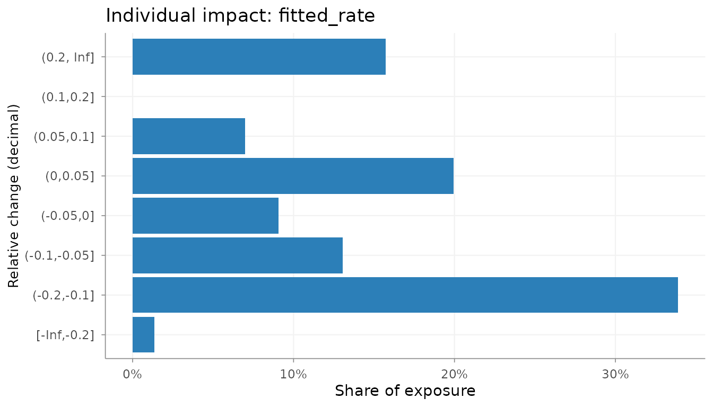

The combined candidate changes the technical risk premium by more than
10% in either direction for **51% of training exposure**, even though
the total expected loss is unchanged on that portfolio. The band plot
makes those shifts visible on both sides of zero. This is a change in
expected claims cost, not in commercial premiums.

## Can the model predict future periods?

For a check of the original frequency specification, a random split by
policy keeps all records of each policy together. Rolling validation
instead uses only earlier years for fitting and the next year for
scoring. A policy may legitimately recur in a later year in this second
exercise. The two scores answer different questions. Rolling deviance is
a total, so compare windows alongside their test sizes; it can be useful
to divide by the number of rows.

``` r

set.seed(1207)
held_out <- validate_performance(
  frequency, train, sampling = "split", cluster = "policy_id",
  sample_fraction = .80, n_resamples = 20, metrics = c("deviance", "gini"),
  show_progress = FALSE
)
summary(held_out$scores)
#>     deviance          gini         
#>  Min.   :284.3   Min.   :-0.01585  
#>  1st Qu.:317.2   1st Qu.: 0.09181  
#>  Median :328.7   Median : 0.12903  
#>  Mean   :328.0   Mean   : 0.13220  
#>  3rd Qu.:335.9   3rd Qu.: 0.19740  
#>  Max.   :372.6   Max.   : 0.25225
validate_performance(
  frequency, train, sampling = "rolling", time = "year", initial = 2,
  metrics = c("deviance", "gini"), show_progress = FALSE
)
#>   iteration train_start train_end test_start test_end n_train n_test deviance
#> 1         1        2020      2021       2022     2022    1442    726 323.7895
#> 2         2        2020      2022       2023     2023    2168    744 316.6368
#> 3         3        2020      2023       2024     2024    2912    730 342.4166
#>        gini
#> 1 0.1368401
#> 2 0.1749085
#> 3 0.2215731

# This fixed-model comparison uses estimation years, so it is descriptive.
autoplot(calibration_analysis(frequency, train, by = "year", conf_level = .95))
```

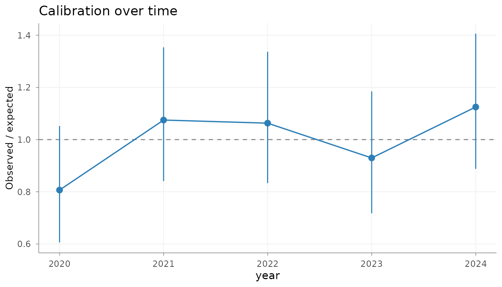

Now score all three specifications on **2025**, without any further
adjustments. The rating tables carry the tariff definitions to the
evaluation records; `segment_sources` connects the new bands to vehicle
value.
[`add_prediction()`](https://mharinga.github.io/insurancerating/reference/add_prediction.md)
adds the expected claim counts and the common severity prediction to the
same records. Frequency deviance scores the claim-count predictions,
while separate observed-to-expected (O/E) ratios show whether the
tariffs predict the right level of claim counts and total loss. A ratio
above one means observed experience exceeded the prediction.

Prepare the evaluation data and the three tariffs

``` r

test <- motor |>
  filter(year == 2025) |>
  add_model_bands()
models <- list(Original = frequency, Smoothed = value_only, Candidate = candidate)
tariff_tables <- lapply(models, rating_table, exposure = FALSE)
tariffs <- list(
  Original = as_tariff(tariff_tables$Original, unmatched = "error"),
  Smoothed = as_tariff(tariff_tables$Smoothed, unmatched = "error",
                       segment_sources = c(vehicle_value_smooth = "vehicle_value")),
  Candidate = as_tariff(tariff_tables$Candidate, unmatched = "error",
                        segment_sources = c(vehicle_value_smooth = "vehicle_value"))
)
```

``` r

test <- add_prediction(
  test, tariffs$Original, tariffs$Smoothed, tariffs$Candidate, severity,
  predictions = c(names(tariffs), "expected_severity")
)
pred_count <- select(test, all_of(names(tariffs)))
pred_loss <- transmute(test, across(all_of(names(tariffs)), ~ .x * expected_severity))
```

    #>      Tariff Factor_levels Frequency_deviance Claim_count_OE  Loss_OE
    #> 1  Original            21           332.7789       1.143658 1.132734
    #> 2  Smoothed            21           333.6000       1.154401 1.129325
    #> 3 Candidate            21           333.3343       1.171832 1.145272

``` r

calibration_analysis(frequency, test, conf_level = .95)
#>   Observed Expected       OE   N Exposure    Upper    Lower Conf_level
#> 1       78 68.20222 1.143658 733 413.6245 1.427337 0.904014       0.95
#>   Interval_method
#> 1         poisson
```

Across the three tariffs, claim-count O/E is around 1.15, while loss O/E
is around 1.13. Both ratios exceed one. Check claim counts and compare
average cost per claim separately before deciding what needs to change.
The displayed count interval applies to the original tariff. It treats
predictions as fixed and assumes independent Poisson counts; it does not
include parameter uncertainty or dependence from recurring policies.

All three tariffs still have 21 factor levels, excluding the intercept.
The refinement changes the relativity pattern; it does not shorten the
tariff table.

Can the alternatives still rank future loss cost? The concentration plot
uses predicted loss per exposure-year. Lift shows observed and predicted
rates relative to their respective portfolio averages. The ordered
Lorenz plot asks a different question: do the records that the candidate
prices higher *relative to the original* also account for a larger share
of losses than the original expected?

``` r

ranking <- discrimination_analysis(
  observed = test$amount, predicted = pred_loss, exposure = test$exposure,
  reference = pred_loss$Original, n_groups = 5
)
ranking$summary[c("Model", "Gini", "Normalized_Gini", "Relative_Gini")]
#>       Model      Gini Normalized_Gini Relative_Gini
#> 1  Original 0.3521816       0.3706460    0.00000000
#> 2  Smoothed 0.3314663       0.3488447   -0.05387948
#> 3 Candidate 0.3305787       0.3479105   -0.02424254
autoplot(ranking)
```

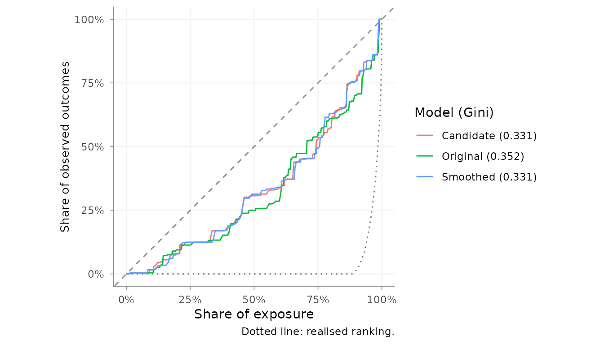

``` r

autoplot(ranking, type = "lift")
```

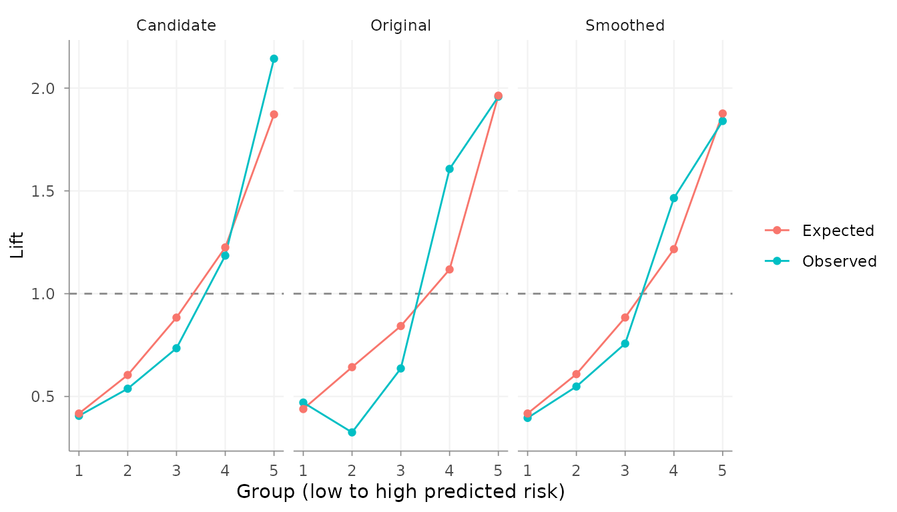

``` r

autoplot(ranking, type = "ordered_lorenz")
```

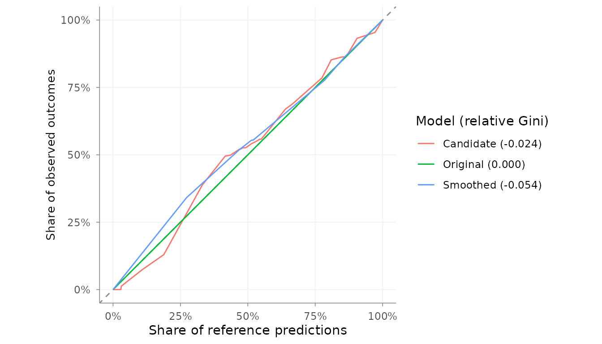

## What would justify adopting a candidate?

On the 2025 holdout, the three tariffs have similar frequency deviance
and loss Gini. The original has slightly lower deviance and a slightly
higher Gini, but one year does not tell us whether those differences
will persist. Similar Gini values also do not imply good calibration:
all three underpredict total loss in 2025.

The decision is whether smoother effects and less reliance on uncertain
regional estimates justify the individual changes seen in the audit.
This example gives no reason to adopt the combined candidate on
predictive performance alone. In practice, investigate the shortfall in
loss predictions and the largest individual changes before making that
decision.
