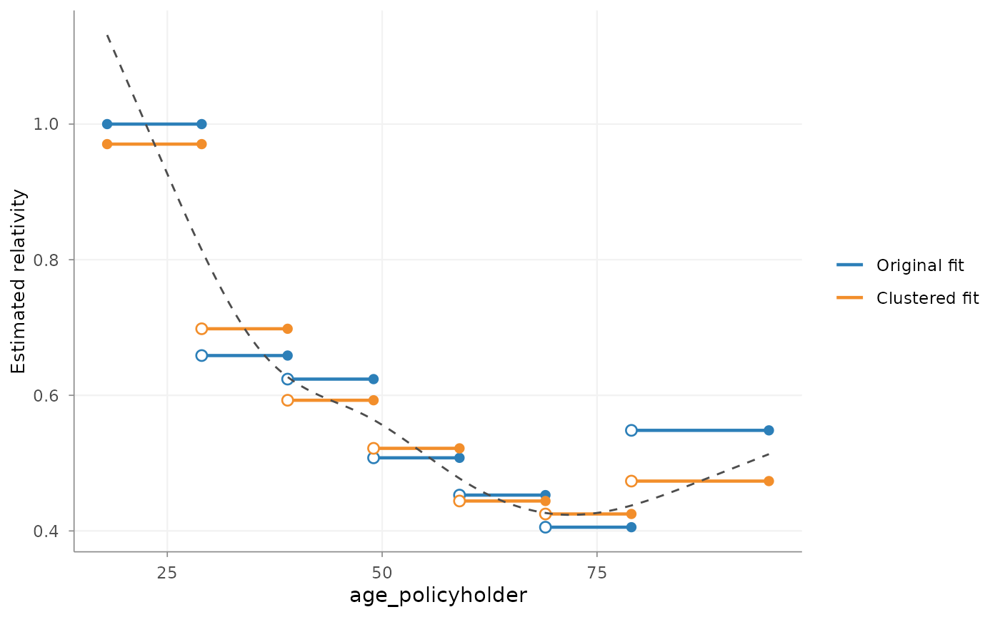
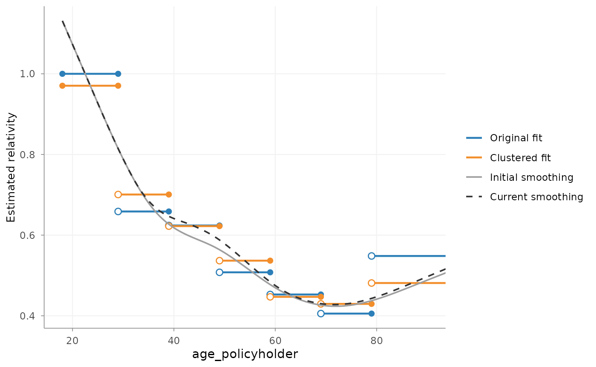
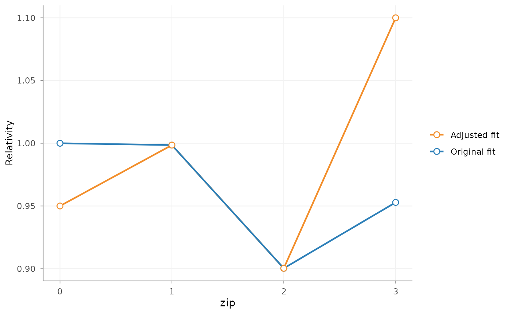
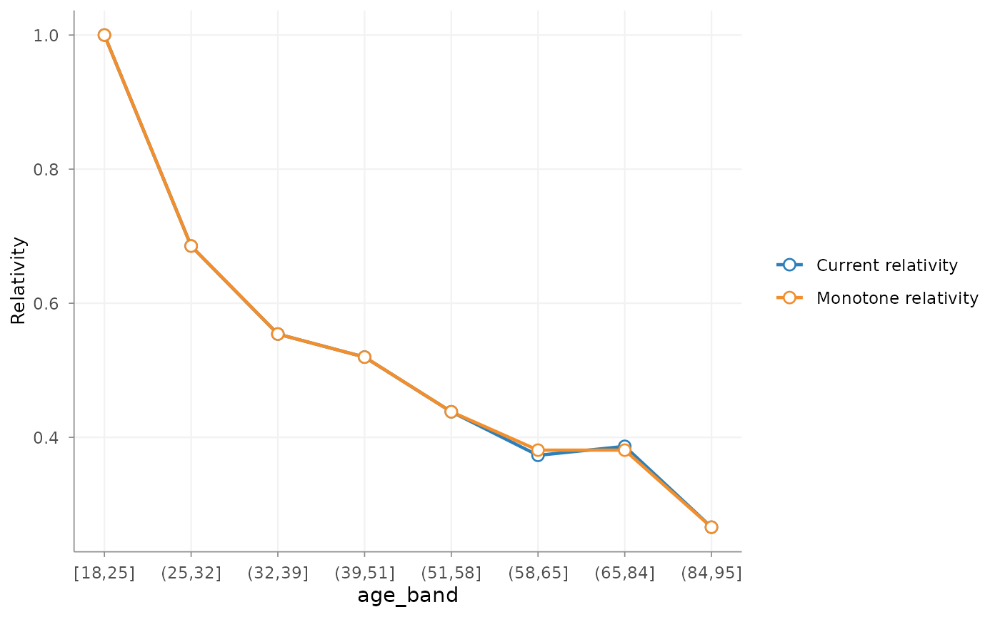
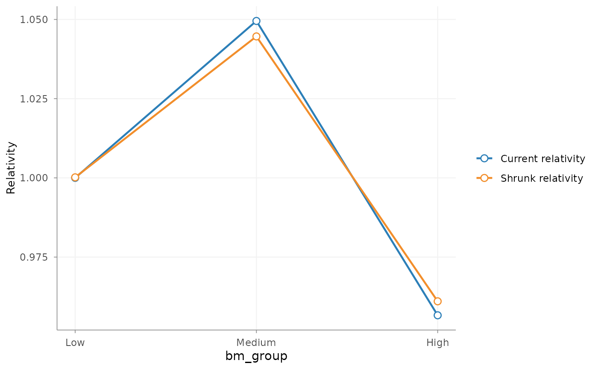

# Refinement building blocks

## Introduction

Refinement turns fitted effects into explicit tariff proposals. You can
review the proposal before refitting, and keep a record of what changed.
Start with the age-band example below, or skip to the [advanced
options](#advanced-refinement-options) for a specific technique. See
[Getting
Started](https://mharinga.github.io/insurancerating/articles/getting-started.md)
for model construction and the [package
map](https://mharinga.github.io/insurancerating/articles/pricing-workflow-building-blocks.md)
for how refinement fits alongside other pricing tasks.

## Quick start

Suppose the age-band relativities of a frequency model are uneven. Here
we compare them with a smoother age effect. The example keeps the same
age bands so that only their relativities change; this is a candidate
tariff, not an assumption about how age must affect every portfolio.

### Fit the starting model

The response is claim count and `log(exposure)` is the offset. ZIP and
bonus-malus remain separate model terms and are used in later examples.

``` r

library(insurancerating)

portfolio <- as.data.frame(MTPL)

age_breaks <- c(18, 25, 32, 39, 51, 58, 65, 84, 95)
portfolio$age_band <- cut(
  portfolio$age_policyholder,
  breaks = age_breaks,
  include.lowest = TRUE
)
portfolio$bm_group <- cut(
  portfolio$bm,
  breaks = c(0, 4, 8, Inf),
  labels = c("Low", "Medium", "High"),
  include.lowest = TRUE
)
portfolio$bm_detail <- factor(as.character(portfolio$bm))
portfolio$zip <- factor(portfolio$zip)

unrestricted <- glm(
  nclaims ~ age_band + zip + bm_group + offset(log(exposure)),
  family = poisson(),
  data = portfolio
)
```

### Smoothing an ordered effect

Fit the curve to the estimated age-band effects using the underlying
numeric age. The breaks define the output bands, and exposure gives more
weight to levels with more portfolio support.

``` r

refinement <- prepare_refinement(unrestricted, data = portfolio) |>
  add_smoothing(
    model_variable = "age_band",
    source_variable = "age_policyholder",
    breaks = age_breaks,
    smoothing = "spline",
    k = 5,
    weights = "exposure"
  )
initial_age_refinement <- refinement
```

### Compare the proposal and refit

``` r

autoplot(refinement, variable = "age_band") +
  ggplot2::labs(x = "Policyholder age")
```



``` r


age_tariff <- refit(refinement, intercept_only = TRUE)
age_effects <- as.data.frame(rating_table(age_tariff, exposure = FALSE))
subset(age_effects, risk_factor == "age_policyholder_smooth")
#>               risk_factor   level est_age_tariff
#> 2 age_policyholder_smooth [18,25]      0.9517847
#> 3 age_policyholder_smooth (25,32]      0.7142379
#> 4 age_policyholder_smooth (32,39]      0.5574783
#> 5 age_policyholder_smooth (39,51]      0.5034194
#> 6 age_policyholder_smooth (51,58]      0.4557071
#> 7 age_policyholder_smooth (58,65]      0.3914753
#> 8 age_policyholder_smooth (65,84]      0.3713782
#> 9 age_policyholder_smooth (84,95]      0.4954763
```

The dashed line is the proposed smooth curve. The resulting age-band
relativities are fixed during the intercept-only refit, which estimates
a new base rate. Keep the `refinement` object to make another proposal;
`age_tariff` is the fitted result. Use
[`audit_refinement()`](#auditing-the-portfolio-effect) to see how
changes in relativities and base rate combine on the portfolio.

## Advanced refinement options

The following examples build on the saved proposal. They are
alternatives or additions, not a required sequence. See
[`?add_smoothing`](https://mharinga.github.io/insurancerating/reference/add_smoothing.md)
for the full list of curve shapes, weights and spline settings.

### Refining a selected part of the smoothing

[`add_smoothing()`](https://mharinga.github.io/insurancerating/reference/add_smoothing.md)
defines the initial curve and its structural assumptions.
[`edit_smoothing()`](https://mharinga.github.io/insurancerating/reference/edit_smoothing.md)
can set explicit target values, adjust the relative level, or scale the
change in the curve after an anchor. These are tariff assumptions
layered on the initial smoothing, not additional statistical
observations.

Each call to
[`edit_smoothing()`](https://mharinga.github.io/insurancerating/reference/edit_smoothing.md)
is stored as a separate refinement step. If the same smoothing is edited
more than once, the edits are applied cumulatively in their recorded
order. The `step` argument in
[`autoplot()`](https://ggplot2.tidyverse.org/reference/autoplot.html)
can therefore be used to inspect the curve after a particular edit
without introducing a separate revision argument.

#### Explicitly redirecting the curve

Use explicit values when the intended targets are known:

``` r

explicit_age_refinement <- refinement |>
  edit_smoothing(
    model_variable = "age_band",
    from = 32,
    to = 65,
    from_value = 0.95,
    to_value = 1.10,
    control_positions = 51,
    control_values = 1.02
  )

autoplot(explicit_age_refinement, variable = "age_band", x_max = 90)
```


The stored edit redirects the selected interval through the supplied
target values. This is appropriate when those values have a documented
actuarial or implementation basis.

#### Applying a relative local adjustment

Use `adjustment` when the current shape is broadly appropriate but one
region should be somewhat higher or lower:

``` r

relative_age_refinement <- refinement |>
  edit_smoothing(
    model_variable = "age_band",
    from = 32,
    to = 65,
    adjustment = 1.05
  )

autoplot(
  relative_age_refinement,
  variable = "age_band",
  x_max = 90,
  show_initial_smoothing = TRUE
)
```


Here, `adjustment = 1.05` raises the middle of the selected region by up
to 5% relative to the existing smoothing. The multiplier starts at 1 at
`from`, moves towards 1.05 over the available smoothing points, and
returns to 1 at `to`. The unchanged curve is therefore retained outside
the interval and no jump is introduced at either boundary.

With `show_initial_smoothing = TRUE`, the plot includes both the curve
directly after
[`add_smoothing()`](https://mharinga.github.io/insurancerating/reference/add_smoothing.md)
and the cumulative curve at the selected step. This comparison changes
only the plot; it does not alter the stored refinement or the subsequent
refit.

For example, two local adjustments create two successive edit steps:

``` r

cumulative_age_refinement <- relative_age_refinement |>
  edit_smoothing(
    model_variable = "age_band",
    from = 50,
    adjustment = 1.02,
    transition = "linear"
  )

# Step 3 is the cumulative result of the initial smoothing and both edits.
autoplot(
  cumulative_age_refinement,
  step = 3,
  x_max = 90,
  show_initial_smoothing = TRUE
)
```



Selecting `step = 2` would show the curve after the first edit only. The
initial comparison line remains the result of the original
[`add_smoothing()`](https://mharinga.github.io/insurancerating/reference/add_smoothing.md)
step in both plots.

For a tail adjustment, only one boundary is needed. With only `from`,
the adjustment runs from that value to the end of the available
smoothing range. With only `to`, it runs from the beginning of the range
to that value. The transition remains attached to the original curve at
the supplied boundary:

``` r

# Refine the upper tail
edit_smoothing(
  refinement,
  model_variable = "age_band",
  from = 50,
  adjustment = 1.05
)

# Refine the lower tail
edit_smoothing(
  refinement,
  model_variable = "age_band",
  to = 35,
  adjustment = 0.95
)
```

With `transition = NULL`, the default, the transition inherits the
smoothing specification of the step being edited. For example, an
original `smoothing = "increasing_concave"` uses the same structural
shape logic while adapting the entry and exit to their opposite
directions. The resulting curve is checked against the inherited
monotonicity and curvature where applicable.

Two explicit alternatives are available:

``` r

# Continuous straight transitions
edit_smoothing(
  refinement,
  model_variable = "age_band",
  from = 32,
  to = 65,
  adjustment = 1.05,
  transition = "linear"
)

# Immediate changes at both boundaries
edit_smoothing(
  refinement,
  model_variable = "age_band",
  from = 32,
  to = 65,
  adjustment = 1.05,
  transition = "step"
)
```

`"linear"` remains continuous. `"step"` deliberately permits
discontinuities and should therefore be selected only when an immediate
tariff change is intended. Relative adjustments and explicit target
values cannot be combined in one
[`edit_smoothing()`](https://mharinga.github.io/insurancerating/reference/edit_smoothing.md)
call because they express different instructions. They can be recorded
in separate consecutive edit steps when that sequence has a clear
actuarial interpretation.

### Adjusting the slope after an anchor

Sometimes the level of the smoothing is acceptable, while the remaining
change above a selected value is to be made stronger or weaker. In that
case, `slope_adjustment` scales the change relative to the smoothing
value at `from`:

``` r

slope_refinement <- refinement |>
  edit_smoothing(
    model_variable = "age_band",
    from = 50,
    slope_adjustment = 1.10
  )

autoplot(
  slope_refinement,
  variable = "age_band",
  show_initial_smoothing = TRUE
)
```


The curve through age 50 is unchanged. Above age 50, each difference
from the relativity at age 50 is multiplied by 1.10. The curve therefore
remains continuous at the anchor. Where the curve falls below its value
at age 50, the decline relative to that anchor is 10% larger. A value
between 0 and 1 flattens the remaining effect. This is different from
`adjustment`, which changes the relative level over a selected interval.

Each
[`edit_smoothing()`](https://mharinga.github.io/insurancerating/reference/edit_smoothing.md)
call records one type of intervention: a relative level adjustment, a
slope adjustment, or explicit target/control-point values. When both
level and slope require adjustment, use two consecutive calls:

``` r

refinement |>
  edit_smoothing(
    model_variable = "age_band",
    from = 30,
    to = 50,
    adjustment = 1.05
  ) |>
  edit_smoothing(
    model_variable = "age_band",
    from = 50,
    slope_adjustment = 1.10
  )
```

The refinement history then retains both actuarial choices as separate
steps.

The transformation preserves the direction of an increasing or
decreasing effect. For a shape-constrained curve, a value above 1 may
nevertheless create a visible change in slope at the anchor and need not
preserve global concavity or convexity across that exact point. This
should therefore be treated as an explicit actuarial intervention and
inspected before refitting.

The remainder of this vignette uses `relative_age_refinement` as the
current proposal:

``` r

refinement <- relative_age_refinement
```

The relativity plot shows the overall tariff shape:

``` r

autoplot(refinement, variable = "age_band")
```


### Interpreting the premium effect

A relativity curve shows the shape of a tariff effect. To read its
magnitude, use
[`premium_change()`](https://mharinga.github.io/insurancerating/reference/premium_change.md)
with a meaningful increment, for example five years of age:

``` r

premium_change(
  refinement,
  variable = "age_band",
  at = seq(20, 60, by = 5),
  increment = 5
)
#> Premium change for age_policyholder
#> 
#> Increment: 5
#> Basis: Effective smoothing curve
#> 
#>  From To Premium change
#>    20 25         -17.7%
#>    25 30         -17.9%
#>    30 35         -13.9%
#>    35 40          -8.6%
#>    40 45          -2.8%
#>    45 50          -2.9%
#>    50 55          -8.9%
#>    55 60         -10.5%
#>    60 65         -10.5%
```

The first row compares the modelled tariff at ages 20 and 25, holding
other factors fixed. It is not a prediction of the change at an
individual policy renewal. The calculation uses the current edited curve
without extrapolating. Omit `increment` to compare a value with twice
that value instead.

For an insured-amount smoothing, `increment = 100000` would ask how much
modelled premium changes for another 100,000 from each displayed
starting value. It might, for example, compare 100,000 with 200,000,
then 200,000 with 300,000. Successive percentage changes may decline,
remain stable or increase depending on the fitted relationship. The
increment is a finite practical comparison, not a derivative or slope,
and no particular pattern is imposed by the package.

By default, `basis = "curve"` evaluates the continuous effective
smoothing at the exact starting and comparison values. This is the
appropriate basis when the question concerns the shape or steepness of
the smoothing itself. To review the premium effect of the implementable
tariff classes instead, use:

``` r

premium_change(
  refinement,
  variable = "age_band",
  at = c(20, 25, 30, 35),
  increment = 5,
  basis = "segments"
)
#> Premium change for age_policyholder
#> 
#> Increment: 5
#> Basis: Tariff segments
#> 
#>  From To Premium change
#>    20 25           0.0%
#>    25 30         -25.0%
#>    30 35         -21.3%
#>    35 40          -6.0%
```

With `basis = "segments"`, the helper determines which effective tariff
interval contains each value and compares the corresponding current
segment relativities. The result can therefore be 0% when both values
are in the same segment, even when the underlying curve changes within
that range. A change can also occur discretely when a comparison crosses
a segment boundary. The two bases answer different questions: the curve
describes the underlying smooth relationship, while the segments
describe the tariff that would be applied.

The initial and edited relationships can be compared directly:

``` r

premium_change(
  relative_age_refinement,
  variable = "age_band",
  at = c(20, 25, 30),
  increment = 5,
  steps = c(1, 2)
) |>
  as_gt()
```

| Premium change for +5 age_policyholder |  |  |  |  |
|----|----|----|----|----|
| Based on the effective continuous smoothing curve |  |  |  |  |
| From | To | Step 1 | Step 2 | Difference |
| 20 | 25 | −17.7% | −17.7% | 0.0 pp |
| 25 | 30 | −17.9% | −17.9% | 0.0 pp |
| 30 | 35 | −14.8% | −13.9% | 0.9 pp |

With two selected states, the table shows both premium changes and their
difference in percentage points. This comparison is often easier to
interpret than small visual differences between two relativity curves.
It remains an interpretation of the proposed smoothing and does not
alter the refinement.

### Restricting selected levels

[`add_restriction()`](https://mharinga.github.io/insurancerating/reference/add_restriction.md)
can fix tariff levels at supplied relativities or apply a multiplier to
their current relativities. A restriction may represent an
implementation rule, a supported external assumption or a deliberate
response to an unstable local estimate. It differs from smoothing:
smoothing estimates a structured pattern, whereas a restriction records
an explicit level decision.

``` r

refinement <- refinement |>
  add_restriction(
    restrictions = c("0" = 0.95, "3" = 1.10),
    model_variable = "zip"
  )
```

Only ZIP levels 0 and 3 are supplied here. The other observed ZIP levels
are fixed at their current effective relativities. Consequently, a
partial restriction changes the selected values but still produces a
complete fixed structure for that risk factor. The named-vector form is
preferred because each level remains directly beside its relativity. A
two-column data frame remains a fully supported alternative; its column
names identify the source factor and generated tariff column.

In that data frame, the level column must be character or factor and the
value column must be numeric. Numeric category codes must be converted
explicitly with
[`as.character()`](https://rdrr.io/r/base/character.html) or
[`factor()`](https://rdrr.io/r/base/factor.html). Named-vector input
such as `c("0" = 1.00, "3" = 1.10)` already uses character labels, even
though the category names look numeric.

Alternatively, `restriction_type = "multiplier"` retains an adjustment
relative to the effect that exists at that point in the refinement. Here
the current ZIP 3 relativity is increased by 10%; it is not stored as a
prematurely calculated fixed value.

``` r

prepare_refinement(unrestricted, data = portfolio) |>
  add_restriction(
    restrictions = c("3" = 1.10),
    model_variable = "zip",
    restriction_type = "multiplier"
  )
#> <rating_refinement>
#> Base model: Poisson GLM (log link)
#> Steps: 1
#>   1. Multiplier restriction: zip -> zip_multiplier (4 levels)
```

Multipliers require an existing level and cannot introduce a new factor
or level. Step order is material: a multiplier after a fixed restriction
scales that fixed value, while a later fixed restriction supersedes
earlier multipliers for the same factor. Both choices remain explicit in
the refinement summary and audit trail.

Repeated calls for the same restricted variable update matching levels
and retain earlier restrictions for levels not supplied again. New
levels may be added when they represent explicit tariff assumptions; new
risk factors require the corresponding portfolio column and an explicit
opt-in. These behaviours are documented in the
[`add_restriction()`](https://mharinga.github.io/insurancerating/reference/add_restriction.md)
reference.

`allow_new_risk_factors = TRUE` is permission to introduce a new fixed
factor, not a requirement that the factor be new. For a factor already
in the GLM or created by an earlier refinement step, it has no
additional effect and does not itself produce a warning or message. This
also holds for multipliers, which still require an existing relativity
and cannot introduce a new factor. The flag does not request replacement
of another model variable.

A new fixed tariff factor can also replace an existing standalone model
term. For example, `add_restriction(..., replaces = "postal_area")`
records that the new classification substitutes for `postal_area` during
[`refit()`](https://mharinga.github.io/insurancerating/reference/refit.md),
rather than adding a second multiplicative effect. The replacement is
shown in the refinement summary and audit. Interactions and transformed
terms must be revised explicitly in the model specification because
removing them is not an unambiguous level restriction.

``` r

autoplot(refinement, variable = "zip")
```



Again, the plot shows the proposed restriction before
[`refit()`](https://mharinga.github.io/insurancerating/reference/refit.md).

### Enforcing an order without smoothing

For grouped continuous variables such as insured amount or
reconstruction value, a tariff may require increasing relativities
without a smooth curve.
[`add_monotonicity()`](https://mharinga.github.io/insurancerating/reference/add_monotonicity.md)
accepts the existing grouped model factor, including ordinary factors
from [`cut()`](https://rdrr.io/r/base/cut.html). Numeric labels such as
`"100"`, `"200"`, `"1000"` and non-overlapping numeric intervals are put
in numeric order. There is no need to convert those factors to
[`ordered()`](https://rdrr.io/r/base/factor.html). Numeric order also
takes precedence for ordered factors: a conflicting declared order
produces a warning, and the projection uses ascending numeric order.
Interval overlap is rejected for both ordinary and ordered factors.

The following alternative uses the existing age bands, whose estimated
effects mostly decrease, to demonstrate the decreasing variant. Choosing
a direction remains an explicit actuarial assumption, not a universal
rule for age. This starts from the unrestricted model and does not
change the refinement below.

``` r

ordinal <- prepare_refinement(unrestricted) |>
  add_monotonicity("age_band", direction = "decreasing", weights = "exposure")
autoplot(ordinal, variable = "age_band")
```



Unlike
[`add_smoothing()`](https://mharinga.github.io/insurancerating/reference/add_smoothing.md),
this keeps the existing categories and only adjusts their relativities;
there is no `source_variable`, new `breaks` or fitted curve. For
non-numeric categories such as `"Low"`, `"Medium"`, `"High"`, declare an
ordered factor with explicit levels before fitting the GLM. That
declared order is retained; alphabetical order is never assumed to be a
tariff order. The original reference level does not have to come first
in the monotonic sequence.

The default isotonic method pools adjacent violations on the
log-relativity scale; equal fitted levels are allowed. It does not fit a
smooth curve. Use `method = "increase_only"` if no level may fall, or
`"decrease_only"` if no level may rise. These restrictions apply to the
factor effect, not the final premium: `refit(ordinal)` fixes the
projected ratios but re-estimates the intercept and remaining free
effects. This differs from estimating a GLM with order constraints in
its likelihood.

After another refinement,
[`add_monotonicity()`](https://mharinga.github.io/insurancerating/reference/add_monotonicity.md)
can be called again for the same model variable. It projects the current
effects and appends a new step; it does not overwrite the earlier
decision. Default output columns receive unique names such as
`age_band_monotone` and `age_band_monotone_1`. At refit, only the latest
effective relativity is applied, without double counting. An explicit
`output_variable` must still name a new column. Reapplying the same
direction to an already monotone effect leaves its values unchanged.

### Shrinking a categorical effect

[`add_shrinkage()`](https://mharinga.github.io/insurancerating/reference/add_shrinkage.md)
reduces the differences between the current relativities of one
categorical risk factor. It is useful when the direction and ordering of
an estimated effect are considered informative, but the spread between
levels is larger than is supported by the available experience or the
intended tariff. Unlike a restriction, shrinkage does not prescribe
individual level values.

``` r

refinement <- refinement |>
  add_shrinkage(
    model_variable = "bm_group",
    credibility = 0.9,
    weights = "exposure"
  )
```

`credibility` is the weight assigned to the current logarithmic effect.
A value of 0.9 retains 90 percent of each level’s deviation from the
common centre; a value of 1 leaves the effect unchanged, while a value
of 0 removes differences between levels. This is a user-selected
refinement parameter, not an automatically estimated Buhlmann or
Buhlmann-Straub credibility factor.

Exposure is the weighting basis used for the common centre in this
frequency example. For a severity model, claim count may be a useful
alternative. Use `weights = "equal"` when every factor level should
receive equal weight rather than representing the observed portfolio
mix.

After shrinkage, the relativities are normalised so their
exposure-weighted arithmetic mean remains equal to its value before
shrinkage. The operation therefore reduces tariff differentiation
without intentionally changing the weighted level of this risk factor.
The later refit can still recalibrate the intercept or other free model
effects.

``` r

autoplot(refinement, variable = "bm_group")
```



This remains a pre-refit comparison: it shows the current estimated
effect and the proposed shrunken structure stored in the refinement
specification.

### Adding differentiation within model levels

[`add_relativities()`](https://mharinga.github.io/insurancerating/reference/add_relativities.md)
addresses a different problem. An unrestricted GLM may use a broad
factor because its detailed levels are individually too sparse for
stable direct estimation. The refinement can retain the broad parent
effect while introducing documented differentiation between selected
sublevels.

The example splits the broad bonus-malus groups `Low` and `Medium` into
their observed detailed values. The preferred named-vector form keeps
each level next to its relativity. The same split can also be supplied
as character `new_levels` plus a separate numeric `relativities` vector.

``` r

bm_relativities <- relativities(
  split_level(
    "Low",
    new_levels = c("1" = 0.95, "2" = 0.98, "3" = 1.02, "4" = 1.05)
  ),
  split_level(
    "Medium",
    new_levels = c("5" = 0.96, "6" = 0.99, "7" = 1.02, "8" = 1.05)
  )
)

refinement <- refinement |>
  add_relativities(
    model_variable = "bm_group",
    split_variable = "bm_detail",
    relativities = bm_relativities,
    exposure = "exposure",
    normalize = TRUE,
    output_variable = "bm_tariff_segment"
  )
```

`model_variable` supplies the parent GLM effect. `split_variable`
identifies the detailed portfolio levels within each parent.
`output_variable` names the resulting hybrid tariff factor; unsplit
parent levels retain their existing model effect.

After refitting,
[`rating_table()`](https://mharinga.github.io/insurancerating/reference/rating_table.md)
reports this output factor and
[`rating_grid()`](https://mharinga.github.io/insurancerating/reference/rating_grid.md)
uses its segment levels instead of the parent grouping. The numeric
split relativity is linked to the new segment, since one parent can now
contain several different relativities. Later shrinkage and rebasing of
`bm_tariff_segment` retain that grouping, also with
`refit(intercept_only = TRUE)`.
[`audit_refinement()`](https://mharinga.github.io/insurancerating/reference/audit_refinement.md)
can therefore review the final segments without discarding the original
variables needed to predict the unrestricted model.

With `normalize = TRUE`, the sublevel relativities are normalised within
each parent so their exposure-weighted average equals one. The split
therefore redistributes the parent effect without changing its
exposure-weighted level. This does not guarantee the same total
predicted premium once other rating factors are taken into account.
Because shrinkage was added first, these sublevel effects use the
shrunken `bm_group` relativities as their parent values. With
`normalize = FALSE`, the supplied relativities are applied directly.

This operation is not equivalent to restriction or smoothing:

- smoothing regularises an ordered effect already represented by the
  model;
- restriction fixes or multiplies selected tariff values;
- shrinkage reduces differences between categorical levels while
  retaining their ordering;
- additional relativities introduce finer differentiation inside a
  broader model level.

Step order matters. A restriction or shrinkage step added before
[`add_relativities()`](https://mharinga.github.io/insurancerating/reference/add_relativities.md)
changes the parent coefficient used as the basis for the split. A later
restriction can instead adjust selected levels of the derived
`output_variable`. With `restriction_type = "multiplier"`, the parent
adjustment is included once in the split; the earlier restricted effect
is replaced in the model offset.

## Combining and reviewing refinements

The four operations now form one ordered specification:

``` r

summary(refinement)
#> Refinement specification
#> 
#> Package: insurancerating 0.8.2.9000
#> Created: 2026-11-22 13:48:40 UTC
#> Observations: 30,000
#> Family: poisson (log link)
#> Base formula:
#>   nclaims ~ age_band + zip + bm_group + offset(log(exposure))
#> Offset: log(exposure)
#> 
#> Refinement steps: 5
#>   1. Smoothing: age_band from age_policyholder (method: spline, k: 5, scale: relativity)
#>      shape = spline; 8 intervals over 18 to 95
#>   2. Smoothing edit: age_band (relative adjustment: 1.05 from 32 to 65, transition: inherited)
#>      relative adjustment = 1.05; transition = inherited; cumulative from smoothing step 1
#>   3. Restriction: zip -> zip_restricted (4 levels)
#>      type = fixed; 0 = 0.9500000; 1 = 0.9954865; 2 = 0.8971513; 3 = 1.1000000
#>   4. Shrinkage: bm_group (credibility: 0.9, weights: exposure, weighted mean preserved)
#>      credibility = 0.9; weights = exposure; weighted mean preserved
#>   5. Relativities: bm_group split by bm_detail -> bm_tariff_segment (normalised: yes)
#>      2 parent levels split: Low, Medium
```

The summary records the base formula, package version, data size and
each refinement in evaluation order. It describes what will be applied;
it does not report a fitted refined model because
[`refit()`](https://mharinga.github.io/insurancerating/reference/refit.md)
has not yet been called.

The variable-specific
[`autoplot()`](https://ggplot2.tidyverse.org/reference/autoplot.html)
calls above evaluate the stored steps in their recorded order. They
therefore inspect the intended tariff after any preceding adjustments
without silently changing the GLM. The `step` argument can be used when
an earlier stage of a longer specification needs to be reviewed
separately.

[`add_rebasing()`](https://mharinga.github.io/insurancerating/reference/add_rebasing.md)
can be inserted when required to change which resulting level is
displayed as one without changing ratios between levels. Rebasing
changes the representation of an effect, whereas shrinkage changes its
degree of differentiation.

## Refitting the model

``` r

refined_model <- refit(
  refinement,
  intercept_only = TRUE
)
#> Warning in update_formula_remove(formula, old_term): Column 'bm_group' must be in model call.
```

[`refit()`](https://mharinga.github.io/insurancerating/reference/refit.md)
applies the stored steps in order, constructs the required tariff
variables and offsets, updates the formula and calls
[`glm()`](https://rdrr.io/r/stats/glm.html) with the original model
family. It does more than copy proposed relativities into an existing
coefficient vector.

The treatment of the remaining model effects depends on
`intercept_only`:

- with `intercept_only = TRUE`, unaffected existing effects are fixed as
  offsets and only the intercept is estimated. Their relative
  differences are preserved while the overall level is recalibrated;
- with `intercept_only = FALSE`, remaining free terms are estimated
  again. Their coefficients may change as the GLM finds a new joint
  optimum conditional on the fixed refinement steps.

Choose between these modes based on which existing relationships are to
remain fixed and which effects can be re-estimated.

The prescribed smoothing, restrictions and sublevel relativities remain
explicit assumptions. Refitting does not turn them into unrestricted
statistical estimates.

## Inspecting the fitted result

After
[`refit()`](https://mharinga.github.io/insurancerating/reference/refit.md),
the result is a fitted GLM and can be reviewed with the normal
interpretation tools:

``` r

head(rating_table(refined_model, exposure = FALSE))
#>      risk_factor       level est_refined_model
#> 1    (Intercept) (Intercept)         0.2568384
#> 2 zip_restricted           0         0.9500000
#> 3 zip_restricted           1         0.9954865
#> 4 zip_restricted           2         0.8971513
#> 5 zip_restricted           3         1.1000000
#> 6       bm_group      Medium         1.0440707
```

This is the **post-refit** result. It is distinct from the preview shown
by `autoplot(refinement)`:

- before
  [`refit()`](https://mharinga.github.io/insurancerating/reference/refit.md):
  proposed tariff adjustments;
- after
  [`refit()`](https://mharinga.github.io/insurancerating/reference/refit.md):
  fitted model under those adjustments.

Printing `refined_model` also reports the original and refitted
formulas, the model family, refit mode and stored refinement steps
before showing the regular GLM output.

## Calibrating the final level

After the tariff structure has been refined and fitted, an externally
selected overall calibration factor can be applied to a log-link model:

``` r

calibrated_model <- adjust_intercept(
  refined_model,
  factor = 1.05
)

evaluation <- extract_model_data(refined_model)
before <- predict(refined_model, newdata = evaluation, type = "response")
after <- predict(calibrated_model, newdata = evaluation, type = "response")
sum(after) / sum(before)
#> [1] 1.05
```

[`adjust_intercept()`](https://mharinga.github.io/insurancerating/reference/adjust_intercept.md)
adds `log(1.05)` to the intercept. Response-scale predictions therefore
increase by exactly 5%, while all non-intercept coefficients and the
ratios between tariff levels remain unchanged. The original
`refined_model` is not modified.

This differs from `refit(intercept_only = TRUE)`. An intercept-only
refit estimates the overall level from the model data conditional on the
stored refinements. Calibration instead applies one explicit total
factor after that fit. It is consequently a final model-level operation:
further refinement and repeated calibration are rejected. If the tariff
structure changes, return to the retained `refinement` specification,
refit it and calibrate the new result.

## Auditing the portfolio effect

Individual coefficient changes are difficult to interpret independently
of the intercept, other model terms and portfolio mix.
[`audit_refinement()`](https://mharinga.github.io/insurancerating/reference/audit_refinement.md)
therefore compares predictions from the unrestricted and refined models
on the same observed portfolio combinations.

``` r

refinement_audit <- audit_refinement(
  refined_model,
  exposure = "exposure",
  metric = "frequency"
)

summary(refinement_audit)
#> Refinement audit
#> 
#> Package: insurancerating 0.8.2.9000
#> Prepared: 2026-11-22 13:48:40 UTC
#> Refitted: 2026-11-22 13:48:46 UTC
#> Audited: 2026-11-22 13:48:46 UTC
#> Measure: frequency (per_exposure)
#> Exposure: exposure
#> 
#> Original formula:
#>   nclaims ~ age_band + zip + bm_group + offset(log(exposure))
#> Refitted formula:
#>   nclaims ~ offset(log(bm_group_rel) + log(bm_group_shrunk) + log(zip_restricted) + 
#>       log(age_band_smooth) + log(exposure))
#> 
#> Refinement steps: 5
#>   1. Smoothing: age_band from age_policyholder (method: spline, k: 5, scale: relativity)
#>      shape = spline; 8 intervals over 18 to 95
#>   2. Smoothing edit: age_band (relative adjustment: 1.05 from 32 to 65, transition: inherited)
#>      relative adjustment = 1.05; transition = inherited; cumulative from smoothing step 1
#>   3. Restriction: zip -> zip_restricted (4 levels)
#>      type = fixed; 0 = 0.9500000; 1 = 0.9954865; 2 = 0.8971513; 3 = 1.1000000
#>   4. Shrinkage: bm_group (credibility: 0.9, weights: exposure, weighted mean preserved)
#>      credibility = 0.9; weights = exposure; weighted mean preserved
#>   5. Relativities: bm_group split by bm_detail -> bm_tariff_segment (normalised: yes)
#>      2 parent levels split: Low, Medium
#> 
#> Portfolio effect
#>   Before: 0.137596
#>   After:  0.137596
#>   Change: -1.95122e-14 (-1.418e-11%)
#> 
#> Largest level changes (10 of 24)
#>              risk_factor   level     before      after       change
#>  age_policyholder_smooth (84,95] 0.06942859 0.12783575  0.058407152
#>           zip_restricted       3 0.13680279 0.15155033  0.014747533
#>           zip_restricted       0 0.14020239 0.12759132 -0.012611074
#>        bm_tariff_segment       8 0.14270460 0.15538814  0.012683531
#>        bm_tariff_segment       4 0.13883017 0.15067141  0.011841241
#>  age_policyholder_smooth [18,25] 0.26142311 0.24440223 -0.017020877
#>        bm_tariff_segment       7 0.14278504 0.15180712  0.009022077
#>        bm_tariff_segment       3 0.13764208 0.14514697  0.007504895
#>  age_policyholder_smooth (65,84] 0.10100599 0.09551705 -0.005488934
#>  age_policyholder_smooth (51,58] 0.11462184 0.11999825  0.005376415
#>  change_ratio
#>    0.84125502
#>    0.10780140
#>   -0.08994907
#>    0.08887962
#>    0.08529300
#>   -0.06510854
#>    0.06318643
#>    0.05452471
#>   -0.05434266
#>    0.04690568
```

This audit uses `refined_model`, before the additional 5% intercept
adjustment. It reports the portfolio-level frequency before and after
refinement and the corresponding changes by final risk-factor level.
These are predictions from the complete model for the observed portfolio
mix, not isolated coefficient differences.

The refinement and audit objects record package version, timestamps,
formulas and ordered steps. This supports reproducibility, peer review
and documentation of actuarial judgement. Organisational approval,
source-data versioning and formal governance remain outside the package
and should be handled by the user’s normal processes.

## When to revisit the model

Refinement is not a substitute for correcting a poor model. If an
implausible effect is caused by incorrect data, exposure errors, missing
interactions, an inappropriate response definition or poor factor
construction, the model or data preparation should be revisited first.
Refinement is most defensible when the statistical model captures the
main risk structure and the remaining adjustment has a clear tariff
rationale.

## Iterating without losing the specification

Retain both the editable specification and the fitted result:

``` r

refined_model <- refit(refinement)

refinement <- refinement |>
  edit_smoothing(
    model_variable = "age_band",
    from = 32,
    to = 65,
    adjustment = 1.03,
    transition = "linear"
  )

updated_model <- refit(refinement)
```

This appends an edit to the current smoothing. Earlier edits to that
curve remain in effect. To compare an alternative instead of building on
the previous edit, start a separate branch from the saved
`initial_age_refinement`.

Calling
[`add_smoothing()`](https://mharinga.github.io/insurancerating/reference/add_smoothing.md),
[`add_restriction()`](https://mharinga.github.io/insurancerating/reference/add_restriction.md)
or another refinement function directly on `refined_model` is
deliberately not supported. Further adjustments belong on the retained
`rating_refinement` object so their ordering and origin remain visible.

## Summary

The specialist workflow is:

1.  start from an unrestricted fitted model;
2.  create one persistent specification with
    [`prepare_refinement()`](https://mharinga.github.io/insurancerating/reference/prepare_refinement.md);
3.  add smoothing, restrictions, shrinkage or sublevel relativities with
    an explicit rationale;
4.  inspect the proposal with
    [`summary()`](https://rdrr.io/r/base/summary.html) and
    [`autoplot()`](https://ggplot2.tidyverse.org/reference/autoplot.html);
5.  use
    [`refit()`](https://mharinga.github.io/insurancerating/reference/refit.md)
    to fit the model under that specification;
6.  inspect the final tariff with
    [`rating_table()`](https://mharinga.github.io/insurancerating/reference/rating_table.md)
    and its portfolio effect with
    [`audit_refinement()`](https://mharinga.github.io/insurancerating/reference/audit_refinement.md).

This separates estimated effects, proposed actuarial adjustments and
final fitted output without treating refinement as an automatic approval
of the result.

## Where to go next

- [Getting
  Started](https://mharinga.github.io/insurancerating/articles/getting-started.md)
  constructs the initial pricing model used as the starting point for
  refinement.
- [Pricing workflow and package building
  blocks](https://mharinga.github.io/insurancerating/articles/pricing-workflow-building-blocks.md)
  places refinement within the wider package architecture.
- [Model
  validation](https://mharinga.github.io/insurancerating/articles/model-validation.md)
  develops the diagnostics used to assess unrestricted and refined
  models.
